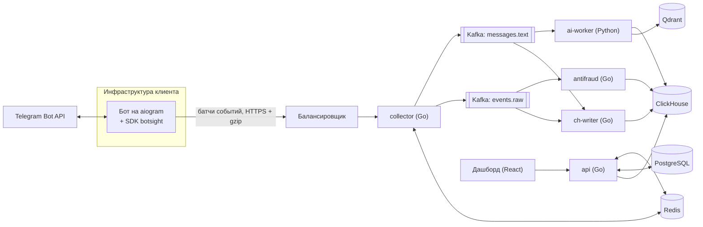

# Botsight

> Аналитика Telegram-ботов в две строки кода.

| | |
|---|---|
| Статус | Концепция и техническое описание, версия 0.1 |
| Дата | 13.10.2026 |
| Команда | 2 человека, университетский курс по Go |
| Стек | Go, Python (SDK, AI), Kafka, ClickHouse, PostgreSQL, Redis, React |

Документ для команды, преподавателя курса и акселератора. Разделы 1–6 описывают продукт, разделы 7–22 — техническую реализацию, разделы 23–28 — организацию работы и коммерциализацию.

## Содержание

1. [Коротко](#1-коротко)
2. [Проблема](#2-проблема)
3. [Решение](#3-решение)
4. [Сценарии использования](#4-сценарии-использования)
5. [Пример подключения: labbot](#5-пример-подключения-labbot)
6. [Принципы продукта](#6-принципы-продукта)
7. [Архитектура](#7-архитектура)
8. [SDK для ботов](#8-sdk-для-ботов)
9. [Формат событий](#9-формат-событий)
10. [Приём событий: collector](#10-приём-событий-collector)
11. [Конвейер данных: Kafka и ClickHouse](#11-конвейер-данных-kafka-и-clickhouse)
12. [Хранилища и схемы](#12-хранилища-и-схемы)
13. [Аналитика и запросы](#13-аналитика-и-запросы)
14. [AI-модуль](#14-ai-модуль)
15. [Антифрод](#15-антифрод)
16. [Дашборд на React](#16-дашборд-на-react)
17. [Наблюдаемость и SLO](#17-наблюдаемость-и-slo)
18. [Нагрузка, надёжность, тестирование](#18-нагрузка-надёжность-тестирование)
19. [Безопасность и персональные данные](#19-безопасность-и-персональные-данные)
20. [Режим прокси Bot API](#20-режим-прокси-bot-api)
21. [Ключевые архитектурные решения](#21-ключевые-архитектурные-решения)
22. [Модули повышенной сложности](#22-модули-повышенной-сложности)
23. [Технологический стек](#23-технологический-стек)
24. [Структура репозитория](#24-структура-репозитория)
25. [Распределение работы](#25-распределение-работы)
26. [Дорожная карта](#26-дорожная-карта)
27. [Монетизация и коммерциализация](#27-монетизация-и-коммерциализация)
28. [Риски и открытые вопросы](#28-риски-и-открытые-вопросы)
29. [Глоссарий](#29-глоссарий)

---

## 1. Коротко

**Botsight** — облачный сервис аналитики для Telegram-ботов. Владелец бота устанавливает Python-пакет `botsight`, добавляет две строки в код запуска бота и получает дашборд:

- откуда приходят пользователи и какой рекламный канал окупается;
- на каком шаге сценария пользователи бросают бота;
- кто и когда блокирует бота;
- какие ошибки возникают в хендлерах и в запросах к Telegram;
- о чём пользователи пишут боту (AI-кластеризация сообщений);
- какая часть трафика — ботофермы.

Остальной код бота (хендлеры, клавиатуры, сценарии) не меняется.

Для команды это проект уровня production: приём большого потока событий на Go, Kafka, ClickHouse, гарантии доставки, нагрузочные и хаос-тесты, React-дашборд и AI-модуль. Для рынка — B2B-продукт с понятной моделью подписки.

## 2. Проблема

Telegram-бот для владельца — чёрный ящик.

1. **Нет воронки.** Владелец видит, сколько людей нажали `/start` (если сам это считает), но не видит, на каком шаге анкеты, каталога или оплаты они уходят.
2. **Непонятно, куда уходят рекламные деньги.** Реклама покупается в десятках каналов, у каждого своя ссылка `t.me/bot?start=метка`, но связать метку с оплатами вручную сложно.
3. **Ошибки узнают от пользователей.** Исключение в хендлере, недоставленные сообщения, блокировки бота — всё это остаётся в логах, которые никто не читает.
4. **Свободные сообщения никто не анализирует.** В боте поддержки тысячи сообщений в день, но тренды («на этой неделе втрое больше жалоб на код подтверждения») никто не видит.
5. **Своя аналитика дорогая.** Каждый раз писать таблицу событий, агрегаты и графики невыгодно, а веб-аналитика не понимает сущностей бота: апдейтов, команд, callback-кнопок, состояний FSM.

## 3. Решение

Подключение — две строки после регистрации роутеров:

```python
from botsight import setup

dp.include_router(router)                       # уже есть в боте
setup(dp, bot, api_key="bs_live_...")           # +1 строка
await dp.start_polling(bot)                     # уже есть в боте
```

Что владелец получает **без изменений в хендлерах**:

| Данные | Откуда берутся |
|---|---|
| Пользователи, DAU/WAU/MAU, новые и вернувшиеся | все входящие апдейты |
| Источники трафика | параметр `/start <метка>` (deep link) |
| Воронки и граф сценария | переходы состояний FSM до и после каждого хендлера |
| «Пользователь застрял на шаге» | хендлер отработал, а состояние FSM не изменилось |
| «Бот не понял пользователя» | апдейт, который не обработал ни один хендлер, или срабатывание запасного хендлера |
| Блокировки и отток | ошибка 403 при отправке, апдейт `my_chat_member` |
| Ошибки и медленные хендлеры | исключения и время обработки каждого хендлера |
| Ошибки Bot API и упирания в лимиты | ответы Telegram на исходящие запросы (400, 403, 429) |
| Отметки деплоев | события запуска и остановки бота |

Что добавляется **по желанию** одной строкой в нужном месте — бизнес-события, которые знает только бот: оплата, оформленный заказ, сгенерированный документ:

```python
botsight.track("purchase", user_id=user.id, props={"amount": 990, "plan": "pro"})
```

Так же устроена веб-аналитика: просмотры страниц собираются сами, а покупки размечаются вручную.

## 4. Сценарии использования

### 4.1. Атрибуция рекламы

Владелец покупает рекламу в 10 каналах и даёт каждому свою ссылку: `t.me/shop_bot?start=ch_tech`, `t.me/shop_bot?start=ch_memes`. Botsight показывает для каждой метки: сколько пользователей пришло, сколько дошло до оплаты, какова конверсия. Если владелец вводит расходы на канал, Botsight считает стоимость привлечения одного платящего пользователя.

### 4.2. Воронка бота-магазина или бота записи

Сценарий `/start → каталог → корзина → оплата` или `/start → услуга → дата → время → подтверждение`. Botsight строит воронку из состояний FSM автоматически и показывает, на каком шаге уходит больше всего людей. После изменения сценария видно, стало ли лучше.

### 4.3. Бот поддержки

Тысячи свободных сообщений в день. AI-модуль группирует их в темы, называет темы человеческим языком и предупреждает о всплесках: «тема "не приходит код" выросла в 3 раза за неделю». Отдельно видна доля сообщений, которые бот не смог обработать.

### 4.4. Mini Apps и игры с наградами

DAU, удержание по когортам, реферальные цепочки и антифрод: какая доля «пользователей» из каждого источника похожа на ботоферму.

## 5. Пример подключения: labbot

[labbot](https://github.com/Artem-Kornilov-pro/labbot) — бот на aiogram 3, который собирает лабораторные работы по варианту. Сценарий — анкета на FSM:

```
Создать лабу → выбор лабы → ФИО → группа → преподаватель → вариант → подтверждение → генерация → файлы
```

### 5.1. Изменения в коде

`requirements.txt`: добавить `botsight`. В `bot/__main__.py`:

```python
from botsight import setup                                          # +1

    dp.include_router(router)
    setup(dp, bot, api_key=os.environ["BOTSIGHT_KEY"],              # +1
          skip_text_in_states={"Form:name"})                         # опционально: не трогать ввод ФИО
```

Хендлеры в `bot/handlers.py` не меняются.

### 5.2. Воронка, которая строится автоматически

| Шаг воронки | Событие в Botsight |
|---|---|
| Начал анкету | переход в `Form:lab` (кнопка «Создать лабу» или `/new`) |
| Выбрал лабу | переход в `Form:name` (хендлер `cb_lab`) |
| Ввёл ФИО | переход в `Form:group` |
| Указал или пропустил группу | переход в `Form:teacher` |
| Указал или пропустил преподавателя | переход в `Form:variant` |
| Ввёл вариант | переход в `Form:confirm` |
| Получил лабу | переход из `Form:confirm` и отправка документов (`sendDocument`) |

### 5.3. Что увидит автор labbot

- **Где застревают.** Регулярное выражение `NAME_WORD` отвергает ввод вида «Иванов И.И.» из-за точек. Если на шаге ФИО много повторных вводов (состояние не меняется), причина почти наверняка в этом.
- **Спрос на платный тариф.** Сколько пользователей упёрлись в лимит `LAB_LIMIT=2`. Это ручное событие `limit_reached` одной строкой.
- **Очередь генерации.** Генерация ограничена семафором `GEN_LIMIT = asyncio.Semaphore(4)`. Ручное событие `lab_generated` с полями `queue_ms` и `gen_ms` покажет, когда перед дедлайнами растёт очередь и пора масштабироваться.
- **Что просят.** Тексты, попавшие в хендлер `fallback`, AI-модуль сгруппирует в темы: например, какую лабу просят добавить.
- **Отток.** Блокировки бота после последней доступной лабы.

### 5.4. Приватность на этом примере

Бот собирает ФИО, группу и преподавателя — это персональные данные. По умолчанию SDK **не отправляет тексты сообщений**: только тип, длину, команду и `callback_data`. Если владелец включит сбор текстов для AI-анализа, параметр `skip_text_in_states={"Form:name"}` исключит ввод ФИО. Содержимое отправленных файлов (.docx с ФИО) не передаётся никогда: SDK видит только имя метода `sendDocument`, чат и результат.

## 6. Принципы продукта

1. **Две строки — и всё работает.** Подключение не требует переписывать бот. Ручные события — опциональное улучшение.
2. **Бот клиента важнее аналитики.** SDK никогда не бросает исключения в код бота, не задерживает обработку апдейтов и ограничен по памяти. Если Botsight недоступен, теряются события, а не работоспособность бота.
3. **Токен бота не покидает инфраструктуру клиента.** SDK работает внутри процесса бота и отправляет только события.
4. **Приватность по умолчанию.** Тексты не собираются, пока владелец явно не включит сбор. Тексты хранятся отдельно и с коротким сроком.
5. **Изоляция клиентов.** `project_id` определяется по ключу API на сервере и присутствует в каждом запросе к хранилищам. Тело запроса не может указать чужой проект.
6. **Измеримость.** У каждого сервиса есть метрики, у системы — SLO. Утверждения о производительности подтверждаются бенчмарками и отчётами нагрузочных тестов.

## 7. Архитектура

### 7.1. Общая схема



### 7.2. Компоненты

| Компонент | Язык | Ответственность | Масштабирование |
|---|---|---|---|
| SDK `botsight` | Python | сбор событий в процессе бота, батчи, ретраи | живёт в каждом боте |
| `collector` | Go | приём батчей, аутентификация, валидация, лимиты, запись в Kafka | без состояния, горизонтально |
| Kafka | — | буфер и шина событий | партиции |
| `ch-writer` | Go | Kafka → ClickHouse пачками, дедупликация, DLQ | по числу партиций |
| `antifraud` | Go | стриминговые признаки, скоринг подозрительных пользователей | по числу партиций |
| `ai-worker` | Python | эмбеддинги, кластеризация тем, NL→SQL, объяснение аномалий | очередь задач |
| ClickHouse | — | события и агрегаты | шарды и реплики |
| PostgreSQL | — | аккаунты, проекты, ключи, настройки | реплика для чтения |
| Redis | — | лимиты, дедупликация батчей, кэш запросов, сессии | один инстанс, позже кластер |
| `api` | Go | REST для дашборда, auth, построитель аналитических запросов | без состояния, горизонтально |
| Дашборд | TypeScript, React | интерфейс клиента | статика на CDN |
| Prometheus, Grafana | — | мониторинг самой системы | — |

**Data plane** (путь событий): SDK → collector → Kafka → ch-writer → ClickHouse. Должен выдерживать нагрузку и не терять данные.
**Control plane** (управление): api, PostgreSQL, дашборд. Должен быть удобным и безопасным.

### 7.3. Путь одного события

1. Пользователь нажимает кнопку в боте. aiogram получает апдейт.
2. Middleware SDK формирует событие и кладёт его в очередь в памяти (`put_nowait`, без ожидания).
3. Фоновая задача SDK собирает батч (до 500 событий или 2 секунды), сжимает gzip и отправляет `POST /v1/batch`.
4. `collector` проверяет ключ, лимит и дубликат батча, валидирует события и пишет их в Kafka с подтверждением от всех реплик.
5. Только после подтверждения Kafka `collector` отвечает `202 Accepted`.
6. `ch-writer` читает партицию, копит пачку и вставляет её в ClickHouse одним INSERT. Смещение в Kafka фиксируется после успешной вставки.
7. Материализованные представления ClickHouse обновляют дневные агрегаты.
8. Дашборд запрашивает данные через `api`. Цель по свежести: событие видно в дашборде через 10 секунд (p95).

## 8. SDK для ботов

Первая версия поддерживает aiogram 3. Формат событий не зависит от фреймворка, поэтому SDK для python-telegram-bot, grammY (Node.js) и telebot (Go) добавляются без изменений на сервере.

### 8.1. Установка и подключение

```bash
pip install botsight
```

```python
from botsight import setup

dp.include_router(router)
setup(dp, bot, api_key=os.environ["BOTSIGHT_KEY"])
```

`setup()` нужно вызвать **до** `start_polling`. aiogram по умолчанию запрашивает у Telegram только те типы апдейтов, для которых есть хендлеры (`resolve_used_update_types()`), и делает это до вызова startup-хуков. При `track_blocks=True` SDK подключает собственный роутер с хендлером `my_chat_member`, и к этому моменту он уже должен быть подключён. Порядок относительно `include_router(...)` не важен: хендлер SDK пропускает апдейт дальше (`SkipHandler`) и не перехватывает хендлеры бота (раздел 8.6).

Неверные параметры вызывают исключение сразу в `setup()`, при запуске бота. После запуска SDK исключений в код бота не бросает. Повторный вызов `setup()` для того же диспетчера возвращает уже созданный клиент.

### 8.2. Что делает `setup()`

```python
def setup(dp: Dispatcher, bot: Bot, api_key: str, **options) -> Botsight:
    client = Botsight(api_key, bot_id=bot.id, **options)     # проверка параметров
    dp["botsight"] = client                                   # доступ из хендлеров для track()
    if not client.options.enabled:
        return client

    dp.update.outer_middleware(UpdateMiddleware(client))     # 1. все входящие апдейты
    steps = StepMiddleware(client)
    dp.message.middleware(steps)                              # 2. шаги FSM и хендлеры
    dp.callback_query.middleware(steps)
    dp.pre_checkout_query.middleware(steps)
    bot.session.middleware(OutgoingMiddleware(client))        # 3. исходящие запросы к Bot API

    if client.options.track_blocks:
        dp.include_router(blocks_router())                    # подписка на my_chat_member

    dp.startup.register(client.start)                         # запуск фоновой отправки
    dp.shutdown.register(client.close)                        # дослать события при остановке
    return client
```

`bot_id` берётся из `bot.id`: это часть токена до двоеточия, сам токен никуда не передаётся. Для апдейтов используется бот из контекста апдейта, поэтому несколько ботов на одном диспетчере тоже различаются.

Inner-middleware, зарегистрированные на диспетчере, aiogram применяет и к хендлерам во вложенных роутерах (`TelegramEventObserver._resolve_middlewares` проходит по цепочке роутеров от корня), поэтому регистрации на `dp` достаточно.

### 8.3. Хук 1: входящие апдейты

Outer-middleware на `dp.update` видит каждый апдейт до фильтров. К моменту его вызова встроенные middleware aiogram уже положили в `data` пользователя (`event_from_user`), чат (`event_chat`) и текущее состояние FSM (`raw_state`).

```python
class UpdateMiddleware(BaseMiddleware):
    def __init__(self, client: Botsight):
        self.client = client

    async def __call__(self, handler, update: Update, data: dict):
        ctx = UpdateContext()                             # общий с хуком шагов этого апдейта
        data["botsight_update_ctx"] = ctx
        t0 = time.perf_counter()
        result = UNHANDLED
        failed = False
        try:
            result = await handler(update, data)
            return result
        except BaseException:
            failed = True                                 # хендлер нашёлся, но упал
            raise
        finally:
            try:
                self._record(update, data, ctx,
                             handled=failed or result is not UNHANDLED,
                             duration_ms=int((time.perf_counter() - t0) * 1000))
            except Exception:
                log_limited(...)                          # ошибка SDK не доходит до бота
```

Из апдейта извлекаются: тип (`update.event_type`), тип содержимого (`message.content_type`), команда и параметр deep link для `/start` (до 64 символов), `callback_data`, новый статус бота для `my_chat_member` (`member_status`), длина текста или подписи, язык и премиум-статус пользователя, наличие username. Текст — только при `capture_text=True` и только если текущее состояние не входит в `skip_text_in_states`.

Апдейт считается необработанным (`handled = false`), если не подошёл ни один хендлер или сработал хендлер из `fallback_handlers` (запасной хендлер «не понял»). Сработавший хендлер узнаёт хук шагов (раздел 8.4), а результат он передаёт через `UpdateContext`.

### 8.4. Хук 2: шаги FSM и хендлеры

Inner-middleware на `message`, `callback_query` и `pre_checkout_query` вызывается после фильтров, поэтому знает, какой хендлер сработал (`data["handler"]`). `pre_checkout_query` нужен для воронки оплаты.

```python
class StepMiddleware(BaseMiddleware):
    async def __call__(self, handler, event, data: dict):
        before = data.get("raw_state")                    # уже прочитано aiogram, бесплатно
        t0 = time.perf_counter()
        error = None
        skipped = False
        try:
            return await handler(event, data)
        except (SkipHandler, CancelHandler):
            skipped = True                                # хендлер отказался: это не шаг
            raise
        except Exception as exc:
            error = type(exc).__name__
            raise                                         # исключение бота не глотаем
        finally:
            if not skipped:
                try:
                    # имя хендлера, отметка fallback, чтение state после хендлера
                    await self._record(event, data, before,
                                       int((time.perf_counter() - t0) * 1000), error)
                except Exception:
                    log_limited(...)
```

Имя хендлера — `module:qualname`. Оно определяется и для `functools.partial`, методов и хендлеров-классов.

Стоимость: одно дополнительное чтение состояния после хендлера. С `MemoryStorage` это обращение к словарю, с `RedisStorage` — один запрос к Redis на апдейт. Отключается параметром `track_fsm=False`: тогда события `step` отправляются с пустыми `state_from` и `state_to`. Если чтение состояния упало (например, Redis недоступен), шаг тоже отправляется без состояний, чтобы не появилось ложного «застрял на шаге».

### 8.5. Хук 3: исходящие запросы

Request-middleware сессии aiogram оборачивает каждый вызов Bot API. Ответ Telegram с ошибкой aiogram превращает в исключение (`TelegramForbiddenError`, `TelegramRetryAfter` и т. д.), которое проходит через middleware.

```python
class OutgoingMiddleware(BaseRequestMiddleware):
    def __init__(self, client: Botsight):
        self.client = client

    async def __call__(self, make_request, bot, method):
        if isinstance(method, GetUpdates):                # long polling не интересен
            return await make_request(bot, method)
        t0 = time.perf_counter()
        try:
            response = await make_request(bot, method)
        except Exception as exc:                          # любое исключение: записать и пробросить
            self._record(bot, method, int((time.perf_counter() - t0) * 1000), exc)
            raise
        self._record(bot, method, int((time.perf_counter() - t0) * 1000), None)
        return response
```

Извлекаются: имя метода (`method.__api_method__`: `sendMessage`, `sendDocument`, `editMessageText`), `chat_id`, длительность, код и нормализованный тип ошибки. Содержимое сообщений и файлов не читается. `chat_id` вида `@channel` передаётся как `0`, потому что в схеме это int64.

Нормализация ошибок:

| Исключение / описание Telegram | Код | `error` |
|---|---|---|
| `TelegramForbiddenError`, «bot was blocked by the user» | 403 | `bot_blocked` |
| `TelegramForbiddenError`, «user is deactivated» | 403 | `user_deactivated` |
| `TelegramForbiddenError`, прочее | 403 | `forbidden` |
| `TelegramRetryAfter` | 429 | `rate_limited` |
| `TelegramMigrateToChat` | 400 | `migrated` |
| `TelegramBadRequest`, «message is not modified» | 400 | `not_modified` |
| `TelegramBadRequest`, прочее | 400 | `bad_request` |
| `TelegramUnauthorizedError` | 401 | `unauthorized` |
| `TelegramNotFound` | 404 | `not_found` |
| `TelegramConflictError` | 409 | `conflict` |
| `TelegramEntityTooLarge` | 413 | `entity_too_large` |
| `TelegramServerError` | 500 | `server_error` |
| `TelegramNetworkError` | 0 | `network` |
| `ClientDecodeError` (ответ Telegram не разобран) | 0 | `decode_error` |
| прочий `TelegramAPIError` | 0 | `api_error` |
| любое другое исключение | 0 | `unknown` |

Успешный запрос: `ok = true`, `error_code = 0`, `error = null`.

### 8.6. Обнаружение блокировок

Два независимых источника:

1. **Ошибка 403 `bot_blocked`** при отправке сообщения. Работает всегда, но только когда бот пытается написать пользователю.
2. **Апдейт `my_chat_member`** со статусом `kicked` в личном чате (`member_status = "kicked"` в событии `update`). Telegram присылает его сразу при блокировке, но только если бот подписан на этот тип апдейтов. При `track_blocks=True` SDK подключает роутер с хендлером `my_chat_member`, и aiogram добавляет этот тип в `allowed_updates`. Сам апдейт записывает хук входящих апдейтов, а хендлер SDK только отмечает, что апдейт ожидаемый, и бросает `SkipHandler`. Поэтому хендлеры бота для `my_chat_member` срабатывают при любом порядке роутеров, а апдейт, который бот сам не обрабатывает, не считается необработанным.

Для ботов на вебхуках `allowed_updates` задаёт владелец в `set_webhook`, например `allowed_updates=dp.resolve_used_update_types()` после `setup()`. Инструкция — в README пакета.

### 8.7. Ручные события

```python
@router.callback_query(Form.confirm, F.data == "gen")
async def cb_generate(cb: CallbackQuery, state: FSMContext, botsight: Botsight):
    ...
    t0 = time.monotonic()
    async with GEN_LIMIT:
        t1 = time.monotonic()
        files = await asyncio.to_thread(lab.generate, ...)
    botsight.track("lab_generated", user_id=cb.from_user.id, props={
        "lab": data["lab"],
        "queue_ms": int((t1 - t0) * 1000),
        "gen_ms": int((time.monotonic() - t1) * 1000),
    })
```

Клиент попадает в хендлер через встроенное внедрение зависимостей aiogram (`dp["botsight"] = client`), так же как в labbot передаются `quota` и `admins`. Вне хендлеров можно вызвать `botsight.track(...)` на уровне модуля: он использует клиент из последнего `setup()`, а без `setup()` ничего не делает. Вместо `user_id` можно передать сам объект `User`.

Правила для ручных событий: имя в `snake_case` до 64 символов, не больше 32 свойств, строки до 1024 символов. Числа и строки хранятся в разных колонках, чтобы по числам можно было считать суммы и перцентили. `bool` превращается в строку `"true"`/`"false"`, `None` и `NaN` пропускаются, остальные значения приводятся к строке. Событие с неверным именем отбрасывается, лишние свойства обрезаются, а в лог пишется предупреждение. Исключений `track()` не бросает.

### 8.8. Доставка событий

| Механизм | Реализация |
|---|---|
| Очередь | `asyncio.Queue(maxsize=10_000)`. События кладутся через `put_nowait`. При переполнении событие выбрасывается, растёт счётчик `dropped`, который уходит в следующем батче и виден в дашборде. В `dropped` попадают и события из батчей, от которых SDK отказался (ответ 400, 10 минут ретраев, слишком большое событие). |
| Батчи | Фоновая задача собирает до 500 событий или ждёт 2 секунды. Батч ограничен и по размеру: меньше 2 МиБ JSON до сжатия. Подготовка батча (идентификаторы, время, псевдонимизация, `redact`, JSON и gzip) идёт в рабочем потоке (`asyncio.to_thread`), а не в event loop бота. HTTP-клиент — `aiohttp`, он уже установлен вместе с aiogram, новых зависимостей нет. |
| Размер события | Лимит collector — 16 КиБ на событие. У слишком большого `update` обрезается `text`, слишком большое ручное событие выбрасывается и учитывается в `dropped`. |
| Идентификаторы | `event_id` и `batch_id` — UUIDv7 (упорядочены по времени), генерируются в SDK. Используется своя реализация на 10 строк для всех версий Python: `event_id` строится от времени события, поэтому упорядочен по моменту события, а не по моменту сборки батча (`uuid.uuid7()` в Python 3.14 время не принимает). |
| Неизменяемость батча | При повторной отправке уходит тот же `batch_id` с теми же событиями. На этом держится дедупликация на сервере. |
| Ретраи | Экспоненциальная задержка с полным джиттером от 0,5 до 60 секунд, не дольше 10 минут на батч. Для 429 учитывается заголовок `Retry-After`. |
| Circuit breaker | После 5 неудачных отправок подряд пауза между попытками не меньше 30 секунд. Очередь продолжает заполняться до лимита. |
| Остановка | На `dp.shutdown` SDK досылает очередь с таймаутом 5 секунд. Неудачная отправка во время остановки не ретраится. |
| Изоляция ошибок | Все хуки обёрнуты в `try/except`. Ошибки самого SDK пишутся в лог не чаще раза в минуту и никогда не доходят до кода бота. |
| Накладные расходы | Цель: меньше 50 мкс на апдейт на горячем пути (сборка словаря и `put_nowait`), сеть — только в фоне. Проверяется бенчмарком в CI (`pytest -m benchmark`). Первый замер: около 7 мкс на апдейт со всеми хуками и `MemoryStorage`. |

Реакция SDK на ответы сервера:

| Ответ | Действие SDK |
|---|---|
| `202 Accepted` | батч доставлен |
| `400 Bad Request` и прочие 4xx | батч выбрасывается и учитывается в `dropped`, ошибка в лог (это баг SDK или клиента, ретрай не поможет) |
| `401 Unauthorized` | SDK выключается до перезапуска: хуки перестают собирать события, ошибка в лог один раз |
| `408`, `409 Conflict` | этот же батч сейчас обрабатывается или запрос не успел, ретрай позже |
| `413 Payload Too Large` | батч делится пополам, половинки отправляются как новые батчи; одиночное событие выбрасывается |
| `429 Too Many Requests` | ретрай после `Retry-After` (не больше 10 минут) |
| `5xx`, таймаут, сеть | ретрай с экспоненциальной задержкой |

### 8.9. Параметры

| Параметр | По умолчанию | Описание |
|---|---|---|
| `api_key` | — | ключ проекта из дашборда |
| `endpoint` | `https://ingest.botsight.ru` | адрес приёма (для self-hosted) |
| `capture_text` | `False` | отправлять тексты и подписи сообщений (до 4096 символов) |
| `skip_text_in_states` | `set()` | состояния FSM, в которых текст не отправляется даже при `capture_text=True`. Строки `"Form:name"`, объекты `State` или целый `StatesGroup` |
| `redact` | `None` | функция `(text) -> text` для собственного маскирования. Вызывается в фоновом потоке. Если она упала, текст не отправляется |
| `pseudonymize_user_ids` | `False` | заменять `user_id` и `chat_id` личных чатов на HMAC-SHA256 с `pseudonymize_secret`: первые 8 байт со сброшенным старшим битом, чтобы значение помещалось в int64 |
| `pseudonymize_secret` | — | секрет для HMAC, обязателен при `pseudonymize_user_ids=True`. Хранится у владельца бота. Его нельзя менять: вместе с ним сменятся все псевдонимы |
| `track_fsm` | `True` | отслеживать переходы состояний |
| `track_blocks` | `True` | подписаться на `my_chat_member` |
| `fallback_handlers` | `()` | запасные хендлеры («не понял»). Апдейт, который попал в них, считается необработанным. Сами функции или строки `"module:qualname"` |
| `batch_size` | `500` | максимум событий в батче (1–500) |
| `flush_interval` | `2.0` | максимум секунд между отправками |
| `max_queue` | `10_000` | лимит очереди в памяти |
| `sample_rate` | `1.0` | доля пользователей, по которым собираются события (выборка по хешу `user_id`, чтобы воронки оставались целыми; для исходящих запросов — по `chat_id`). События без пользователя (`lifecycle`) отправляются всегда |
| `enabled` | `True` | выключить SDK, например в тестах. Хуки не ставятся, `track()` ничего не делает, но `botsight` по-прежнему передаётся в хендлеры |

## 9. Формат событий

Формат — контракт между SDK и сервером. Версия указывается в батче, сервер поддерживает текущую и предыдущую версии.

### 9.1. Батч

`POST /v1/batch`, тело в gzip:

```json
{
  "schema_version": 1,
  "batch_id": "0192f6c8-4d1e-7a3b-9c55-3f1a2b6c7d80",
  "sent_at": "2026-10-13T00:12:47.002Z",
  "sdk": {
    "name": "botsight-python",
    "version": "0.1.0",
    "framework": "aiogram",
    "framework_version": "3.31.0"
  },
  "dropped": 0,
  "events": [ ... ]
}
```

### 9.2. Общие поля события

| Поле | Тип | Описание |
|---|---|---|
| `event_id` | UUIDv7 | уникальный идентификатор, генерируется в SDK |
| `type` | string | `update`, `step`, `outgoing`, `custom`, `lifecycle` |
| `name` | string | подтип: `message`, `callback_query`, `sendMessage`, `purchase`, `bot_started` |
| `ts` | RFC 3339, мс | время события по часам бота |
| `bot_id` | int64 | id бота (часть токена до двоеточия, токен не передаётся) |
| `user_id` | int64 | id пользователя Telegram или его псевдоним |
| `chat_id` | int64 | id чата (отрицательный для групп) |

Общие поля есть у каждого события; если пользователя или чата нет, передаётся `0`. Необязательные поля, неприменимые к событию (`content_type`, `command`, `start_param`, `callback_data`, `member_status`, `text`, `user`), не передаются вовсе. Сервер хранит их как `''` и `0`.

### 9.3. Типы событий

**`update`** — входящий апдейт:

```json
{
  "event_id": "0192f6c8-4d1e-7a3b-9c55-3f1a2b6c7d81",
  "type": "update",
  "name": "message",
  "ts": "2026-10-13T00:12:45.123Z",
  "bot_id": 7012345678,
  "user_id": 123456789,
  "chat_id": 123456789,
  "chat_type": "private",
  "content_type": "text",
  "command": "start",
  "start_param": "vk_ads_oct",
  "text_len": 17,
  "state": "",
  "user": { "lang": "ru", "is_premium": false, "has_username": true },
  "handled": true,
  "duration_ms": 41
}
```

Для нажатия кнопки: `"name": "callback_query"`, `"callback_data": "lab:lab2"`. Для изменения статуса бота в чате: `"name": "my_chat_member"`, `"member_status": "kicked"`. В личном чате это означает блокировку.

**`step`** — обработка хендлером (`name`: `message`, `callback_query` или `pre_checkout_query`):

```json
{
  "event_id": "0192f6c8-4d1e-7a3b-9c55-3f1a2b6c7d82",
  "type": "step",
  "name": "callback_query",
  "ts": "2026-10-13T00:12:51.900Z",
  "bot_id": 7012345678,
  "user_id": 123456789,
  "chat_id": 123456789,
  "handler": "bot.handlers:cb_lab",
  "state_from": "Form:lab",
  "state_to": "Form:name",
  "duration_ms": 12,
  "error": null
}
```

**`outgoing`** — запрос к Bot API (при успехе `"ok": true`, `"error_code": 0`, `"error": null`):

```json
{
  "event_id": "0192f6c8-4d1e-7a3b-9c55-3f1a2b6c7d83",
  "type": "outgoing",
  "name": "sendDocument",
  "ts": "2026-10-13T00:13:05.410Z",
  "bot_id": 7012345678,
  "user_id": 0,
  "chat_id": 123456789,
  "ok": false,
  "error_code": 403,
  "error": "bot_blocked",
  "duration_ms": 87
}
```

**`custom`** — ручное событие:

```json
{
  "event_id": "0192f6c8-4d1e-7a3b-9c55-3f1a2b6c7d84",
  "type": "custom",
  "name": "lab_generated",
  "ts": "2026-10-13T00:13:04.950Z",
  "bot_id": 7012345678,
  "user_id": 123456789,
  "props": { "lab": "lab2", "queue_ms": 340, "gen_ms": 2150 }
}
```

**`lifecycle`** — `bot_started` и `bot_stopped`. Версии SDK, фреймворка и Python лежат в `props` (`sdk_version`, `framework`, `framework_version`, `python_version`). На графиках дашборда это отметки деплоев.

### 9.4. Тексты

При `capture_text=True` у события `update` появляется поле `text` (до 4096 символов — максимум длины сообщения в Telegram). `collector` вырезает его из основного события и отправляет в отдельный топик `messages.text` (раздел 11). Основной поток событий персональных текстов не содержит.

### 9.5. Эталонный батч

Полный пример батча со всеми типами событий лежит в [`docs/contract/batch_v1.json`](docs/contract/batch_v1.json). Тесты SDK проверяют, что каждое событие содержит ровно поля из этого файла. Тесты `collector` должны разбирать этот же файл. Изменение формата начинается с правки этого файла и раздела 9.

## 10. Приём событий: collector

### 10.1. API

```
POST /v1/batch
Authorization: Bearer bs_live_ab12cd34_<секрет>
Content-Type: application/json
Content-Encoding: gzip
```

Ограничения: до 500 событий, до 2 МиБ после распаковки, одно событие до 16 КиБ, события не старше 7 дней. `Content-Encoding` — `gzip` или без сжатия.

Ответ `202 Accepted`:

```json
{ "accepted": 498, "duplicate": false, "rejected": 2 }
```

`rejected` — события, не прошедшие проверку (неверный `event_id`, неизвестный `type`, старше 7 дней и т. п.). Они отбрасываются по одному, остальной батч принимается. Для повтора уже принятого батча `accepted` — число событий из первого приёма, `duplicate: true`.

### 10.2. Обработка запроса

1. **TLS** завершается на балансировщике.
2. **Защита от перегрузки.** Инстанс обрабатывает не больше `INGEST_MAX_INFLIGHT` батчей одновременно (по умолчанию 512). Сверх этого — сразу `503` с кодом `overloaded` и `Retry-After: 1`, без очереди в памяти.
3. **Аутентификация.** Ключ имеет вид `bs_live_<префикс 8 символов>_<секрет>`. По префиксу ключ и настройки проекта ищутся в кэше в памяти (TTL 60 с), при промахе — в PostgreSQL. Одновременные промахи по одному префиксу дают один запрос к базе (singleflight). Несуществующие префиксы кэшируются на 10 секунд, чтобы случайные ключи не нагружали базу. Сравнивается SHA-256 полного ключа через `subtle.ConstantTimeCompare`. Отзыв ключа рассылается всем инстансам через Redis Pub/Sub и сразу сбрасывает кэш.
4. **Распаковка с лимитом.** `gzip.Reader` и буферы берутся из `sync.Pool`, распакованные данные читаются через `io.LimitReader` на 2 МиБ: zip-бомба останавливается на 2 МиБ.
5. **Дедупликация и лимит приёма** — один Lua-скрипт в Redis на батч (10.4).
6. **Валидация и нормализация** каждого события. Обрезка строк до лимитов, сервер ставит `received_at`. Расхождение часов определяется по `sent_at` батча: если часы бота расходятся с сервером больше чем на 24 часа, у всех событий батча `ts` заменяется на `received_at` с флагом `clock_skewed`. При нормальных часах события старше 7 дней отбрасываются.
7. **Разделение.** Тексты уходят в `messages.text`, только если у проекта включён `capture_text`. Если сбор текстов выключен, сервер отбрасывает текст, даже если SDK его прислал. Остальное идёт в `events.raw`, метаданные батча (версии SDK, `dropped`, число отклонённых событий) — в `ingest.batches`. `project_id` берётся только из ключа.
8. **Запись в Kafka.** Все записи батча отправляются вместе, затем — ожидание подтверждения каждой (`acks=all`, идемпотентный продюсер). Контекст отправки не зависит от соединения клиента: если клиент отключился, батч всё равно дописывается до конца.
9. **Ответ** `202` — только после подтверждения Kafka. Если Kafka недоступна — `503`, ключ батча удаляется, и повтор SDK обрабатывается заново.
10. **`projects.bot_id`** заполняется в фоне по первому принятому событию.

### 10.3. Коды ответов

| Код | Когда |
|---|---|
| 202 | батч принят или уже был принят ранее (`"duplicate": true`) |
| 400 | неверный JSON, схема, `schema_version` или повреждённый gzip |
| 401 | нет ключа, неверный или отозванный ключ |
| 409 | батч с таким `batch_id` сейчас обрабатывается другим запросом |
| 413 | больше 2 МиБ после распаковки |
| 415 | неподдерживаемый `Content-Encoding` |
| 429 | превышен лимит проекта, есть `Retry-After` |
| 503 | Kafka или Redis недоступны, промах кэша ключей при недоступном PostgreSQL, перегрузка инстанса (`overloaded`), остановка. Всегда с `Retry-After` |

Ошибки — `{"error": {"code", "message"}}`.

### 10.4. Дедупликация батчей

SDK может отправить батч повторно, если не дождался ответа, хотя сервер его уже принял. Дедупликация идёт по батчу, а не по каждому событию. Вместе с лимитом приёма это один Lua-скрипт: один запрос в Redis на батч.

```
EVAL admit  KEYS: batch:{project_id}:{batch_id}, rl:{project_id}
  ├─ ключ батча есть   → done:<N>    → 202, duplicate: true, accepted: N
  │                    → processing  → 409, SDK повторит позже
  ├─ не хватает токенов → 429, Retry-After по скорости пополнения бакета
  └─ иначе: списать токены, SET batch:... processing EX 120
        → обработка → успех: SET batch:... done:<N> EX 86400 → 202
                    → ошибка Kafka: DEL batch:...           → 503
```

Состояние `processing` нужно, чтобы не потерять батч: если бы второй запрос сразу получил `202`, а первый упал на записи в Kafka, события пропали бы.

Токен-бакет — на проект (`INGEST_RATE` событий в секунду, запас `INGEST_BURST`; по умолчанию 2000 и 20 000), время берётся из Redis (`TIME`), поэтому часы инстансов collector не влияют. Шумный клиент упирается в свой лимит и не забирает пропускную способность у остальных. Ключи `batch:{42}:...` и `rl:{42}` содержат одинаковый hash tag `{42}` и попадают в один слот Redis Cluster, так что скрипт будет работать и в кластере.

### 10.5. Производительность

- Буферы и `gzip.Reader` переиспользуются через `sync.Pool`.
- В MVP JSON декодируется стандартной библиотекой. Затем профилирование через `pprof` и сравнение с кодогенерацией или потоковым парсером. В v1 — переход на Protobuf + zstd с замером выигрыша.
- Один запрос в Redis на батч (лимит и дедупликация), ни одного запроса к PostgreSQL на горячем пути.
- Записи всех одновременных запросов собираются продюсером в общие пачки (`linger` 5 мс, zstd), поэтому число запросов к Kafka растёт медленнее числа батчей.
- Первый замер — в разделе 18.2.
- Начиная с Go 1.25 `GOMAXPROCS` по умолчанию учитывает CPU-лимиты cgroup в контейнере.

### 10.6. Остановка без потерь

По `SIGTERM` инстанс переключает readiness-пробу в «не готов» и 2 секунды ждёт, пока балансировщик это заметит. Затем текущие запросы дорабатывают (каждый ждёт подтверждения Kafka), продюсер досылает буфер (`Flush`), и процесс завершается.

## 11. Конвейер данных: Kafka и ClickHouse

### 11.1. Топики

| Топик | Ключ | Партиции | Хранение | Содержимое |
|---|---|---|---|---|
| `events.raw` | `project_id:user_id` | 24 | 72 ч | все события без текстов |
| `messages.text` | `project_id:user_id` | 12 | 24 ч | тексты, только проекты с `capture_text` |
| `ingest.batches` | `project_id` | 6 | 72 ч | метаданные принятых батчей: версии SDK, `dropped`, отклонённые события |
| `events.dlq` | исходный | 3 | 7 дней | записи, которые не удалось обработать, с заголовками исходного топика, партиции, смещения и ошибки |
| `alerts` | `project_id` | 3 | 7 дней | аномалии и срабатывания антифрода (появится вместе с antifraud) |

Топики создаёт `internal/kafka` при старте collector и ch-writer (`KAFKA_CREATE_TOPICS`), автосоздание в брокере выключено. Существующие топики не меняются: число партиций и срок хранения в продакшене меняют осознанно. Значение записи — JSON нормализованного события (`internal/event`).

У событий без пользователя (исходящие запросы, `user_id = 0`) ключ — `project_id:chat_id`: в личном чате это тот же пользователь, и его события остаются в одной партиции.

**Почему ключ `project_id:user_id`, а не `project_id`.** Ключ по проекту дал бы горячую партицию у крупного клиента. Ключ по пользователю распределяет нагрузку равномерно и сохраняет порядок событий одного пользователя внутри партиции. Это нужно `antifraud`, который считает окна по пользователю в памяти.

Настройки продюсера (franz-go): `acks=all`, идемпотентность (по умолчанию в franz-go), сжатие zstd, `linger` 5 мс, таймаут доставки записи 10 с. Настройки топиков: `replication.factor=3`, `min.insync.replicas=2` в продакшене, 1 реплика в локальном окружении. В заголовках записи передаются `schema_version` и `project_id`; `trace_id` добавится вместе с OpenTelemetry.

### 11.2. ch-writer

Отдельный сервис вместо встроенного движка Kafka в ClickHouse. Причины: контроль размера пачек, дедупликация, DLQ и метрики. Встроенный движок используется как эталон для сравнения в бенчмарке.

1. Читает топики `events.raw`, `messages.text` и `ingest.batches` в consumer group `ch-writer`. Каждой назначенной партиции — своя горутина.
2. Копит пачку по каждой партиции: 50 000 строк или 1 секунда (`CHWRITER_BATCH_ROWS`, `CHWRITER_FLUSH_INTERVAL`).
3. Перекладывает записи в колонки и вставляет через нативный протокол со сжатием LZ4 (`clickhouse-go`: `PrepareBatch` → `Append` → `Send`).
4. Фиксирует смещение в Kafka только после успешной вставки.
5. Записи, которые не удалось разобрать, уходят в `events.dlq` и не блокируют партицию.
6. Если ClickHouse недоступен — ретраи с экспоненциальной задержкой до 30 секунд и пауза чтения партиции (`PauseFetchPartitions`). Чтение тоже встаёт на паузу, если в буфере партиции больше 4 пачек. Растёт лаг (`botsight_consumer_lag`), данные ждут в Kafka, память не растёт.
7. При отзыве партиции (ребаланс) горутина дожидается текущей вставки и фиксации и останавливается, буфер без фиксации отбрасывается — новый владелец прочитает его сам. По `SIGTERM` буферы дописываются (до 10 секунд), смещения фиксируются, затем инстанс выходит из группы.

### 11.3. Дубли при падении ch-writer

Проблема: ch-writer вставил пачку, но упал до фиксации смещения. После рестарта он прочитает те же записи и вставит их снова.

Решение — токен дедупликации вставки ClickHouse:

- Каждая вставка выполняется с настройкой `insert_deduplication_token = "{topic}/p{partition}/{first_offset}-{last_offset}"`. ClickHouse отбрасывает повторную вставку блока с тем же токеном (для нереплицированной таблицы нужна настройка `non_replicated_deduplication_window`).
- Токен работает, только если после рестарта пачка соберётся с **теми же границами**. Поэтому перед вставкой ch-writer сохраняет план `writer:plan:{topic}:{partition} = first-last` в Redis. Если после рестарта (или на другом инстансе после ребаланса) чтение партиции начинается ровно с `first`, первая пачка собирается ровно до `last`. Если смещения ушли вперёд, план не нужен и игнорируется.
- Для материализованных представлений включается `deduplicate_blocks_in_dependent_materialized_views = 1`, а у целевых таблиц агрегатов (`events_daily`, `user_first_start`) тоже задаётся `non_replicated_deduplication_window`: повтор отбрасывается средствами целевой таблицы, иначе агрегаты посчитают дубль.
- Проверено тестом `TestCrashBetweenInsertAndCommit`: ch-writer «падает» после вставки, до фиксации смещения, новый экземпляр дочитывает партиции. В `events` и в `events_daily` ровно по одной копии каждого события.

### 11.4. Итоговая семантика доставки

| Участок | Гарантия | Механизм |
|---|---|---|
| SDK → collector | at-least-once | ретраи с тем же `batch_id` |
| collector | дубли батчей отсекаются | `SET NX` в Redis |
| collector → Kafka | без дублей при ретраях продюсера | идемпотентный продюсер |
| Kafka → ClickHouse | at-least-once, дубли отсекаются | токен вставки, детерминированные границы пачек |
| **Итого** | **каждое принятое событие ровно один раз в ClickHouse** | проверяется сверкой в хаос-тестах (раздел 18) |

Единственные допустимые потери — события, выброшенные SDK при переполнении очереди. Они учитываются в счётчике `dropped` и попадают в таблицу `ingest_batches`.

Известное ограничение: если Kafka подтвердила только часть записей батча и collector ответил `503`, повтор SDK запишет подтверждённые события второй раз. Это редкий случай частичного сбоя брокера. Закрыть его можно транзакционным продюсером (батч записывается атомарно, ch-writer читает с `read_committed`) — ценой задержки и сложности. Решение отложено до замеров на стенде.

## 12. Хранилища и схемы

### 12.1. ClickHouse: события

```sql
CREATE TABLE events
(
    project_id     UInt32,
    bot_id         UInt64,
    event_id       UUID,
    ts             DateTime64(3, 'UTC'),
    received_at    DateTime64(3, 'UTC'),
    clock_skewed   UInt8,                    -- ts заменён на received_at (10.2)
    type           LowCardinality(String),   -- update | step | outgoing | custom | lifecycle
    name           LowCardinality(String),
    user_id        UInt64,
    chat_id        Int64,
    chat_type      LowCardinality(String),
    content_type   LowCardinality(String),
    command        LowCardinality(String),
    start_param    String,
    callback_data  String,
    state          LowCardinality(String),   -- состояние в момент апдейта
    handler        LowCardinality(String),
    state_from     LowCardinality(String),
    state_to       LowCardinality(String),
    member_status  LowCardinality(String),   -- my_chat_member: kicked = блокировка в личном чате
    handled        UInt8,
    ok             UInt8,
    duration_ms    UInt32,
    error_code     UInt16,
    error          LowCardinality(String),
    text_len       UInt16,
    user_lang      LowCardinality(String),
    is_premium     UInt8,
    has_username   UInt8,
    props_str      Map(LowCardinality(String), String),
    props_num      Map(LowCardinality(String), Float64)
)
ENGINE = MergeTree
PARTITION BY toYYYYMM(ts)
ORDER BY (project_id, bot_id, toDate(ts), user_id, ts)
TTL toDateTime(ts) + INTERVAL 13 MONTH
SETTINGS non_replicated_deduplication_window = 1000;
```

Решения:
- **`ORDER BY`** начинается с `project_id`: каждый запрос дашборда фильтрует по проекту, и ClickHouse читает только его гранулы. Затем дата для диапазонов времени и `user_id` для воронок и когорт, которые группируют по пользователю.
- **`LowCardinality`** для колонок с небольшим числом значений (типы, команды, состояния): словарное кодирование, меньше места и быстрее фильтры.
- **Партиции по месяцам**: удаление старых данных — это удаление целых партиций.
- **Две карты свойств** (`props_str`, `props_num`): по числам можно считать `sum`, `avg`, `quantile` без приведения типов.
- Пустые значения хранятся как `''` и `0`, без `Nullable`: так быстрее.

Схема ClickHouse — в миграциях [`migrations/clickhouse/`](migrations/clickhouse/), их применяет контейнер `migrate-clickhouse` (golang-migrate). Первый замер на 6 млн событий нагрузочного генератора: около 23 байт на событие после сжатия, в 4,3 раза меньше несжатых данных.

Метаданные батчей — отдельная таблица `ingest_batches` (`project_id`, `batch_id`, `received_at`, версии SDK и фреймворка, `events`, `rejected`, `dropped`). По ней дашборд покажет потери в SDK и версии SDK у клиентов.

### 12.2. ClickHouse: тексты

```sql
CREATE TABLE messages_text
(
    project_id  UInt32,
    bot_id      UInt64,
    event_id    UUID,
    ts          DateTime64(3, 'UTC'),
    user_id     UInt64,
    state       LowCardinality(String),
    handled     UInt8,
    text        String
)
ENGINE = MergeTree
PARTITION BY toYYYYMMDD(ts)
ORDER BY (project_id, ts)
TTL toDateTime(ts) + INTERVAL 30 DAY
SETTINGS non_replicated_deduplication_window = 1000;
```

Тексты хранятся 30 дней в отдельной таблице. Доступ к ней есть только у `ai-worker` и у экранов, где владелец явно смотрит примеры сообщений. Темы `ai-worker` пишет в отдельные таблицы, а не обновляет тексты: изменения в ClickHouse — тяжёлые мутации.

Таблицы AI-модуля (миграция `migrations/clickhouse/000002_ai.up.sql`):

| Таблица | Содержимое |
|---|---|
| `message_points` | какому вектору (уникальному нормализованному тексту) соответствует каждое сообщение; 30 дней |
| `point_topics` | тема каждого вектора по последнему запуску кластеризации (`ReplacingMergeTree` по `assigned_at`) |
| `topics` | темы проекта: название, описание, ключевые слова, число сообщений за 7 дней и за предыдущие 7, доли, рост, примеры, центроид; текущая строка читается через `FINAL` |
| `alerts` | алерты из топика `alerts`: тренды тем и аномалии; пишет ch-writer |

Тема привязана к уникальному тексту, а не к сообщению: одинаковые жалобы 500 пользователей — один вектор, но 500 сообщений в подсчёте размера и тренда.

### 12.3. ClickHouse: агрегаты

Дневные агрегаты для экрана «Обзор»:

```sql
CREATE TABLE events_daily
(
    project_id  UInt32,
    bot_id      UInt64,
    day         Date,
    type        LowCardinality(String),
    name        LowCardinality(String),
    events      SimpleAggregateFunction(sum, UInt64),
    users       AggregateFunction(uniqCombined, UInt64)
)
ENGINE = AggregatingMergeTree
ORDER BY (project_id, bot_id, day, type, name)
SETTINGS non_replicated_deduplication_window = 1000;   -- 11.3

CREATE MATERIALIZED VIEW events_daily_mv TO events_daily AS
SELECT
    project_id, bot_id, toDate(ts) AS day, type, name,
    count() AS events,
    uniqCombinedState(user_id) AS users
FROM events
GROUP BY project_id, bot_id, day, type, name;
```

`uniqCombined` для больших множеств использует HyperLogLog. Его состояния объединяются: DAU за день — это `uniqCombinedMerge(users)` по всем строкам дня, без повторного чтения сырых событий.

Первое касание пользователя для атрибуции:

```sql
CREATE TABLE user_first_start
(
    project_id   UInt32,
    user_id      UInt64,
    first_start  SimpleAggregateFunction(min, DateTime64(3, 'UTC')),
    source       AggregateFunction(argMin, String, DateTime64(3, 'UTC'))
)
ENGINE = AggregatingMergeTree
ORDER BY (project_id, user_id)
SETTINGS non_replicated_deduplication_window = 1000;

CREATE MATERIALIZED VIEW user_first_start_mv TO user_first_start AS
SELECT project_id, user_id, min(ts) AS first_start, argMinState(start_param, ts) AS source
FROM events
WHERE type = 'update' AND command = 'start'
GROUP BY project_id, user_id;
```

### 12.4. PostgreSQL: control plane

Схема — в миграциях [`migrations/postgres/`](migrations/postgres/). В локальном окружении их применяет контейнер `migrate` (golang-migrate), в интеграционных тестах — тот же набор файлов.

| Таблица | Содержимое |
|---|---|
| `accounts` | почта (в нижнем регистре), хеш пароля argon2id, `telegram_id` и username, имя, время подтверждения почты. Должен быть хотя бы один способ входа: почта или Telegram |
| `account_tokens` | одноразовые ссылки из писем: подтверждение почты (48 часов) и сброс пароля (1 час). Хранится только SHA-256 токена и адрес, на который ушло письмо |
| `projects` | название, `bot_id` (по первому событию), тариф, настройки в JSONB: `capture_text`, `neutral_handlers` |
| `project_members` | роль участника: `owner`, `editor` или `viewer`. Владельцев может быть несколько, отдельного `owner_id` у проекта нет |
| `api_keys` | префикс `bs_live_ab12cd34` (уникальный), SHA-256 полного ключа, название, кто создал, время отзыва |
| `saved_funnels` | сохранённые воронки: название и определение в JSONB (шаги, окно, разбивка) |
| `ad_spend` | расходы по метке deep link за период дней `DATERANGE`, сумма `NUMERIC(12, 2)` |

Решения:
- **Последний владелец.** Смена роли и удаление участника идут в транзакции с блокировкой строки проекта: проект нельзя оставить без владельца, даже если два запроса пришли одновременно.
- **Расходы не пересекаются.** Ограничение `EXCLUDE USING gist (project_id WITH =, source WITH =, period WITH &&)` (расширение `btree_gist`) не даёт дважды учесть расходы одной метки за один день.
- **Удаление проекта** каскадно удаляет участников, ключи, воронки и расходы. Префиксы активных ключей перед этим публикуются в `keys:revoked`.

### 12.5. Redis

| Ключ | Тип, TTL | Назначение |
|---|---|---|
| `rl:{project_id}` | hash | токен-бакет лимита приёма |
| `batch:{project_id}:{batch_id}` | string, до 24 ч | дедупликация батчей |
| `writer:plan:{partition}` | string | границы текущей пачки ch-writer |
| `qcache:{hash}` | string, 60 с | кэш тяжёлых запросов дашборда |
| `session:{sha256(token)}` | hash, 30 дней с последнего запроса | сессия дашборда: `account_id`, CSRF-токен, время входа. В cookie лежит сам токен, в Redis — только его хеш |
| `account_sessions:{account_id}` | set | сессии аккаунта, чтобы завершить их все после смены или сброса пароля |
| `rl:{правило}:{ключ}` | string, окно лимита | счётчики попыток входа, регистрации и сброса пароля (раздел 19.5) |
| `keys:revoked` | Pub/Sub | сброс кэша ключей во всех collector |

### 12.6. Qdrant

Коллекция `messages`: один вектор (384 измерения, косинусная близость) на уникальный нормализованный текст проекта. Идентификатор точки — UUIDv5 от проекта и текста, поэтому одинаковые тексты не считаются заново. В payload — `project_id`, `last_ts` (последнее появление текста), `event_id` (последнее сообщение с этим текстом, для примеров) и `words` (число содержательных слов).

Для многих клиентов: `project_id` — keyword-индекс с `is_tenant`, Qdrant хранит точки проекта вместе; HNSW строится по каждому проекту отдельно (`payload_m`); `last_ts` — основной индекс по диапазону (`is_principal`). Изоляция клиентов — обязательный фильтр по `project_id` в каждом запросе. Векторы старше 30 дней удаляются раз в сутки, вместе с текстами.

## 13. Аналитика и запросы

### 13.1. Метрики

| Метрика | Определение |
|---|---|
| DAU / WAU / MAU | уникальные `user_id` с хотя бы одним событием `update` за день, неделю, 30 дней |
| Новые пользователи | первый `update` пользователя попал в период |
| Блокировки | уникальные пользователи с `bot_blocked` или `my_chat_member` → `kicked` |
| Доля необработанных апдейтов | `update` с `handled = 0` к общему числу |
| Повторы на шаге | события `step` без ошибки, где `state_from = state_to`, состояние не пустое, а хендлер не отмечен как нейтральный |
| Время обработки | p50 / p95 / p99 `duration_ms` по хендлерам |
| Ошибки | исключения в хендлерах (`step.error`) и ошибки Bot API (`outgoing.error`) |
| Конверсия источника | доля пользователей с первым `/start <метка>`, совершивших целевое событие |
| Стоимость привлечения | `ad_spend.amount_rub` / число целевых пользователей источника |

### 13.2. Примеры запросов

Воронка анкеты labbot за 30 дней (окно 24 часа):

```sql
SELECT level, count() AS users
FROM
(
    SELECT
        user_id,
        windowFunnel(86400)(
            toDateTime(ts),
            type = 'step'   AND state_to = 'Form:lab',
            type = 'step'   AND state_to = 'Form:name',
            type = 'step'   AND state_to = 'Form:group',
            type = 'step'   AND state_to = 'Form:teacher',
            type = 'step'   AND state_to = 'Form:variant',
            type = 'step'   AND state_to = 'Form:confirm',
            type = 'custom' AND name = 'lab_generated'
        ) AS level
    FROM events
    WHERE project_id = {project_id:UInt32}
      AND ts >= now() - INTERVAL 30 DAY
    GROUP BY user_id
)
GROUP BY level
ORDER BY level;
```

`level` — номер последнего достигнутого шага. Число дошедших до шага `k` — сумма по всем `level >= k`; это считает `api`.

Где пользователи застревают:

```sql
SELECT
    state_from AS step,
    countIf(state_from = state_to)              AS retries,
    uniqExactIf(user_id, state_from = state_to) AS users_with_retries
FROM events
WHERE project_id = {project_id:UInt32}
  AND type = 'step' AND state_from != '' AND error = ''
  AND handler NOT IN {neutral_handlers:Array(String)}
  AND ts >= now() - INTERVAL 7 DAY
GROUP BY step
ORDER BY retries DESC;
```

Не каждый хендлер, после которого состояние не изменилось, означает повтор ввода: `/help` посреди анкеты тоже не меняет состояние. Такие хендлеры владелец отмечает в настройках проекта как нейтральные (`neutral_handlers`), падения хендлеров считаются отдельно как ошибки.

Атрибуция по первому касанию:

```sql
WITH first_touch AS
(
    SELECT user_id, argMin(start_param, ts) AS source
    FROM events
    WHERE project_id = {project_id:UInt32}
      AND type = 'update' AND command = 'start'
    GROUP BY user_id
)
SELECT
    if(source = '', '(без метки)', source) AS source,
    count() AS users,
    countIf(user_id IN (
        SELECT user_id FROM events
        WHERE project_id = {project_id:UInt32}
          AND type = 'custom' AND name = 'purchase'
    )) AS buyers,
    round(buyers / users * 100, 1) AS conversion_pct
FROM first_touch
GROUP BY source
ORDER BY users DESC;
```

В продакшене этот запрос читает готовую таблицу `user_first_start` (`argMinMerge(source)`) вместо сырых событий.

Удержание по недельным когортам:

```sql
SELECT
    cohort_week,
    count()   AS users,
    sum(r[2]) AS week_1,
    sum(r[3]) AS week_2,
    sum(r[4]) AS week_3
FROM
(
    SELECT
        e.user_id,
        c.cohort_week,
        retention(
            toMonday(e.ts) = c.cohort_week,
            toMonday(e.ts) = c.cohort_week + INTERVAL 1 WEEK,
            toMonday(e.ts) = c.cohort_week + INTERVAL 2 WEEK,
            toMonday(e.ts) = c.cohort_week + INTERVAL 3 WEEK
        ) AS r
    FROM events AS e
    INNER JOIN
    (
        SELECT user_id, toMonday(min(ts)) AS cohort_week
        FROM events
        WHERE project_id = {project_id:UInt32} AND type = 'update'
        GROUP BY user_id
    ) AS c USING (user_id)
    WHERE e.project_id = {project_id:UInt32} AND e.type = 'update'
    GROUP BY e.user_id, c.cohort_week
)
GROUP BY cohort_week
ORDER BY cohort_week;
```

Граф сценария (переходы FSM):

```sql
SELECT state_from, state_to, count() AS transitions, uniqExact(user_id) AS users
FROM events
WHERE project_id = {project_id:UInt32}
  AND type = 'step' AND state_from != state_to
  AND ts >= {from:DateTime64(3)} AND ts < {to:DateTime64(3)}
GROUP BY state_from, state_to;
```

Сценарии ботов содержат циклы («начать заново»), а диаграмма Sankey циклы не поддерживает. Поэтому граф рисуется как направленный граф с толщиной рёбер по числу пользователей, а для Sankey циклы разворачиваются по номеру шага.

### 13.3. API для дашборда

| Метод | Путь | Назначение |
|---|---|---|
| GET | `/v1/projects/{id}/overview?from&to` | DAU, новые, блокировки, ошибки, отметки деплоев |
| GET | `/v1/projects/{id}/fsm-graph?from&to` | граф переходов |
| POST | `/v1/projects/{id}/funnels/query` | воронка по определению: шаги, окно, разбивка |
| GET | `/v1/projects/{id}/sources?from&to&goal` | атрибуция и стоимость привлечения |
| GET | `/v1/projects/{id}/retention?period=week` | когорты |
| GET | `/v1/projects/{id}/errors?from&to` | ошибки хендлеров и Bot API |
| GET | `/v1/projects/{id}/users/{user_id}/timeline` | события одного пользователя |
| GET | `/v1/projects/{id}/topics` | AI-темы и тренды |
| POST | `/v1/projects/{id}/ask` | вопрос на естественном языке |
| GET | `/v1/projects/{id}/live` | поток событий в реальном времени (SSE) |

Плюс управление (реализовано в сервисе `api`):

| Группа | Эндпоинты |
|---|---|
| Вход | `POST /v1/auth/register`, `/login`, `/telegram`, `/logout`, `/password-reset`, `/password-reset/confirm`, `/verify-email` |
| Аккаунт | `GET`/`PATCH /v1/account`, `POST /v1/account/password`, `/verify-email`, `/telegram` (привязка), `DELETE /v1/account/sessions` |
| Проекты | `GET`/`POST /v1/projects`, `GET`/`PATCH`/`DELETE /v1/projects/{id}` |
| Участники | `GET`/`POST /v1/projects/{id}/members`, `PATCH`/`DELETE /v1/projects/{id}/members/{account_id}` |
| Ключи | `GET`/`POST /v1/projects/{id}/keys`, `DELETE /v1/projects/{id}/keys/{key_id}` |
| Воронки | `GET`/`POST /v1/projects/{id}/funnels`, `GET`/`PUT`/`DELETE /v1/projects/{id}/funnels/{funnel_id}` |
| Расходы | `GET`/`POST /v1/projects/{id}/ad-spend`, `DELETE /v1/projects/{id}/ad-spend/{spend_id}` |
| AI | `GET /v1/projects/{id}/topics`, `GET /v1/projects/{id}/topics/{topic_id}/examples`, `GET /v1/projects/{id}/alerts`, `POST /v1/projects/{id}/ask` |
| Антифрод | `GET /v1/projects/{id}/antifraud`, `GET /v1/projects/{id}/antifraud/users` |

Права: `viewer` читает, `editor` ещё меняет настройки, воронки и расходы, `owner` ещё управляет ключами и участниками и удаляет проект. Участник может сам выйти из проекта. Чужой проект отвечает `404`, а не `403`, чтобы нельзя было проверить его существование. Ошибки — `{"error": {"code", "message", "field"}}` со стабильными кодами, дашборд показывает по ним свои тексты.

Спецификация — OpenAPI в [`backend/api/openapi.yaml`](backend/api/openapi.yaml), из неё генерируются типы TypeScript для фронтенда. Тест сверяет её с маршрутами роутера: недокументированный эндпоинт ломает сборку.

Правила построителя запросов:
- SQL строится из типизированных определений (шаги воронки — структуры, а не строки). Значения передаются только как параметры запроса ClickHouse `{name:Type}`.
- `project_id` подставляется из сессии после проверки членства в проекте.
- Тяжёлые запросы кэшируются в Redis на 60 секунд с ключом из хеша запроса и округлённого диапазона времени.
- У пользователя ClickHouse для `api` настроены `max_execution_time`, `max_memory_usage`, `max_rows_to_read`.

## 14. AI-модуль

Работает только для проектов с `capture_text=True`. Сервис `ai-worker` на Python (`ai/`): экосистема ML там богаче, а Go остаётся на пути данных. Один образ запускается как `embed` (векторизация, масштабируется партициями `messages.text`), `topics`, `anomalies` (часовые задачи, проект или час берёт один инстанс по блокировке в Redis), `serve` (внутренний HTTP для `api`) или `all`.

Без LLM модуль работает: темы называются ключевыми словами, аномалии объясняются шаблоном. Недоступны только вопросы на естественном языке.

### 14.1. Темы и тренды сообщений

1. **Чтение** из `messages.text` в consumer group `ai-worker`; смещение фиксируется после записи векторов.
2. **Нормализация и дедупликация.** Нижний регистр, схлопывание пробелов, замена ссылок, почт, телефонов и чисел на токены (`<url>`, `<email>`, `<phone>`, `<num>`). Один эмбеддинг на уникальный текст проекта.
3. **Эмбеддинги** локальной моделью `paraphrase-multilingual-MiniLM-L12-v2` (384 измерения, 220 МБ) через fastembed (ONNX, без PyTorch), батчами на CPU. Модель встроена в образ: тексты не уходят во внешние сервисы. На коротких русских сообщениях поддержки темы разделяются с ARI 0,78; модель `paraphrase-multilingual-mpnet-base-v2` (768 измерений) даёт 0,87 при размере в 3,5 раза больше и подключается переменной `AI_EMBEDDING_MODEL`.
4. **Хранение** векторов в Qdrant (12.6), связи «сообщение → вектор» — в ClickHouse (`message_points`).
5. **Кластеризация** раз в час по каждому проекту с новыми текстами: HDBSCAN по векторам за 7 дней (до 20 000 самых свежих; при больше 5000 — сначала PCA до 50 измерений). Минимальный размер темы растёт с объёмом, чтобы крупный проект не дробился на сотни микротем. Тексты без содержательных слов («привет», «ок», «как дела») в кластеризацию не попадают: на тестах они склеивали в одну «тему» короткие вопросы из разных тем.
6. **Стабильные темы.** Новые кластеры сопоставляются со старыми темами по близости центроидов (порог 0,8), поэтому у темы сохраняются идентификатор, название и история. Остальные тексты за 14 дней получают ближайшую тему, если близость не ниже 0,6.
7. **Названия тем.** Для каждой новой темы берутся 10 текстов, ближайших к центру, и отправляются в LLM с просьбой дать название и описание. Число вызовов LLM равно числу новых тем, а не сообщений. Без LLM название — три ключевых слова по c-TF-IDF (слова, частые в теме и редкие в остальных).
8. **Тренды.** Доля темы в сообщениях за последние 7 дней сравнивается с предыдущими 7 днями (если там хотя бы 50 сообщений). Рост в 3 раза и больше при объёме от 20 сообщений — алерт `topic_trend`, не больше одного на тему в неделю.
9. **Метрика стоимости** — CPU-секунды эмбеддингов, токены и рубли LLM (`LLM_PRICE_RUB_PER_1K_TOKENS`) в метриках Prometheus, делятся на число сообщений в Grafana. Лимит текстов в день на проект (`AI_DAILY_TEXT_LIMIT`, по умолчанию 20 000), сверх лимита — устойчивая выборка каждого десятого.

### 14.2. Вопросы на естественном языке

Пользователь пишет «сколько людей из канала ch_tech оплатили на этой неделе?», получает график и SQL, по которому он построен.

1. LLM получает описание схемы `events` с пояснением смысла колонок, а также контекст проекта: найденные состояния FSM, команды, имена ручных событий, метки источников.
2. LLM возвращает SQL и тип графика из разрешённого списка.
3. **Проверка до выполнения** разбором SQL (sqlglot): ровно одно выражение `SELECT` (можно `WITH` и `UNION`), только таблица `events` и подзапросы из `WITH`, без табличных функций, `SETTINGS`, `INTO OUTFILE`, `FORMAT` и функций, которые выходят за пределы таблицы (`file`, `url`, `remote`, `dictGet`, `getSetting` и т. п.), не длиннее 4000 символов.
4. **Выполнение под отдельным пользователем ClickHouse проекта** (`nl_p{project_id}`):
   - row policy `project_id = {project_id}` на `events` — даже если LLM напишет запрос по чужому проекту, база вернёт только свои строки;
   - права только на `SELECT` из `events`, без грантов на табличные функции и внешние источники (`url`, `file`, `remote`, `s3`);
   - профиль `readonly = 1`, `max_execution_time = 10`, `max_result_rows = 10000`, ограничение памяти.
   Пользователь создаётся при первом вопросе проекта; пароль выводится из секрета `AI_NL_PASSWORD_SECRET` (HMAC), поэтому его нигде не нужно хранить. Словарь проекта для LLM тоже читается под этим пользователем — в подсказку не попадают названия из других проектов.
5. SQL показывается пользователю: ответ можно проверить.
6. `api` проверяет членство в проекте и ограничивает вопросы (30 в час на аккаунт), затем вызывает `ai-worker` с общим внутренним токеном. Тесты проверяют, что запрос LLM к чужому `project_id` возвращает только свои строки, а пользователь `nl_p*` не может читать другие таблицы, менять настройки и писать.

### 14.3. Объяснение аномалий

1. **Обнаружение — статистика, а не LLM.** Через 5 минут после конца каждого часа: активные пользователи (аномалия — падение), ошибки хендлеров и Bot API и блокировки (аномалия — рост). База — медиана того же часа недели за последние 4 недели. Отклонение — робастный z-score на основе MAD (масштаб не меньше √медианы, чтобы при 4 точках не делить на ноль), порог `AI_ANOMALY_Z` = 4, плюс минимальное абсолютное и относительное изменение. Проекту нужна история: активность хотя бы в 3 из 4 базовых часов. Ряды считаются одним запросом сразу по всем проектам и только для 5 нужных часов, поэтому стоимость растёт с числом активных проектов, а не с длиной истории. Конверсия ключевой воронки добавится вместе с построителем запросов воронок.
2. **Разложение.** Для аномалии считается вклад сегментов: хендлеры и типы ошибок для ошибок, источник блокировки для блокировок, команды и состояния для активности. Рядом — события `bot_started` (деплои) за 2 часа до аномалии.
3. **Текст.** LLM получает только посчитанные факты в JSON и пишет 2–3 предложения: «Ошибки в 14:00 МСК выросли до 121 при обычных 12, почти все — в хендлере `cb_pay` (KeyError). За 40 минут до этого бот перезапускался». LLM ничего не считает сам; без LLM текст собирается по шаблону.
4. **Доставка** алертов: топик `alerts` → таблица `alerts` → `GET /v1/projects/{id}/alerts` и дашборд. Отправка через Telegram-бота Botsight — отдельная задача.

### 14.4. Где запускать LLM

Тексты пользователей — персональные данные. Передача их иностранному провайдеру — трансграничная передача (раздел 19). Поэтому используются модели, размещённые в РФ (GigaChat, YandexGPT), или открытая модель на своём сервере (через vLLM или Ollama). Провайдер скрыт за интерфейсом, чтобы его можно было заменить.

## 15. Антифрод

Задача — оценить долю ботоферм в трафике каждого источника. Особенно важно для Mini Apps и игр с наградами, где за «пользователей» платят.

### 15.1. Сигналы

| Сигнал | Как считается | Почему подозрительно | Вес |
|---|---|---|---|
| Скорость ответов (`fast_steps`) | интервалы между сообщениями и нажатиями пользователя: не меньше 4 интервалов, 60 % из них короче 400 мс | человек читает ответ бота и печатает; никто не вводит ФИО за 200 мс | 0,35 |
| Синхронность (`synced_timing`) | сигнатура тайминга — первые 5 интервалов в корзинах по 100 мс («1.1.1.1.1»); одинаковая сигнатура у 10 и больше пользователей проекта | один скрипт с фиксированными паузами водит много аккаунтов | 0,35 |
| Реферальный граф (`referral_ring`) | метки `ref_<user_id>` → граф «пригласил → приглашённый», компоненты через union-find. Сеть — компонента от 10 аккаунтов, где половина подозрительны по поведению, или «звезда» с 30+ приглашёнными, из которых 70 % без username | ферма накручивает рефералку своими аккаунтами | 0,5 |
| Однородность профилей (`homogeneous_source`) | в источнике от 30 пользователей 70 % без username, и это вдвое больше, чем в проекте в целом; учитывается для пользователей без username | фермы создают аккаунты пачками с одинаковыми настройками | 0,15 |
| «Возраст» аккаунта (`fresh_accounts`) | «свежие» — `user_id` в верхних 5 % всех активных пользователей; источник, где их не меньше 40 % и втрое больше, чем в проекте | `user_id` в Telegram растёт со временем регистрации — грубая оценка | 0,15 |
| Всплеск `/start` (`start_spike`) | новые пользователи метки за минуту: от 20 и в 10 раз выше среднего по метке за сутки; только у меток с историей от 6 часов | закупленный «трафик» приходит пачкой | 0,15 |

Оценка пользователя — сумма весов сработавших сигналов, не больше 1. Подозрительный — от 0,5. Поведение (скорость, синхронность) весит больше профиля: ферма может купить аккаунты с username, но скрипт выдаёт себя таймингом. Сигналы источника сами по себе пользователя не помечают, только вместе с поведением.

### 15.2. Реализация

```
events.raw → antifraud (поток) → user_features ─┐
                                                ├─ раз в минуту: SQL-скоринг по всем проектам → user_risk, source_risk
user_first_start (источник) ────────────────────┤                                            → алерт в alerts
referral_flags ← реферальный граф (union-find) ─┘
```

- **Поток.** Сервис `antifraud` на Go читает `events.raw` в consumer group `antifraud`. Ключ `project_id:user_id` даёт каждому инстансу своё подмножество пользователей: признаки пользователя (интервалы, сигнатура, профиль) считаются в памяти без координации. Время — время событий, а не часы сервиса, поэтому результат детерминирован и при перечитывании.
- **Состояние без хранилища.** Смещения не фиксируются: при назначении партиции чтение начинается с «сейчас минус 24 часа» (`ANTIFRAUD_REPLAY`). Перезапуск или ребаланс восстанавливает признаки перечитыванием, тест это проверяет. Память ограничена: пользователи без активности сутки вытесняются, сверх `ANTIFRAUD_MAX_USERS` вытесняются самые давно активные. Изменившиеся признаки пишутся в `user_features` раз в 10 секунд.
- **Скоринг в ClickHouse.** Признаки источников и проекта, синхронность и всплески требуют пользователей со всех инстансов, поэтому оценка считается одним SQL-запросом сразу по всем проектам раз в минуту (один инстанс на минуту, блокировка в Redis). Наружу выходят только маленькие результаты: подозрительные пользователи (`user_risk`) и сводка по источникам (`source_risk`). Источник пользователя — из `user_first_start`.
- **Реферальный граф** пересобирается целиком для проектов с метками `ref_` за последние сутки (по рёбрам за всё время хранения, до 5 млн), раз в `ANTIFRAUD_GRAPH_EVERY` запусков. Инкрементальное обновление и поиск плотных подграфов — модуль повышенной сложности (§22).
- **Алерт** `fraud`: в источнике за сутки от 30 подозрительных и это не меньше половины пользователей. Не чаще раза в сутки на источник, через топик `alerts`.
- **API:** `GET /v1/projects/{id}/antifraud` (доля подозрительных по источникам и причины) и `GET /v1/projects/{id}/antifraud/users` (подозрительные пользователи с оценкой и причинами).
- Скоринг в MVP — взвешенные правила. Позже — логистическая регрессия на размеченных данных.

### 15.3. Проверка на инъекциях

`loadgen -fraud 0.2` добавляет к обычному трафику ботов двух видов: скриптовую ферму `promo_farm` (аккаунты без username, свежие `user_id`, паузы 120–180 мс) и реферальную ферму `ref_<id>` из таких же аккаунтов, половина которых управляется скриптом, половина — «вручную» с человеческими паузами. Обычные пользователи: 85 % с username, разные языки, паузы от 1,2 секунды.

Замер на 5 проектах, 2480 пользователей, 20 секунд нагрузки:

| | Пользователи | Помечены |
|---|---|---|
| `promo_farm` | 255 | 254 (99,6 %) |
| реферальная ферма | 240 | 240 (100 %) |
| обычные пользователи | 1985 | 0 (0 %) |

CI повторяет эту проверку в docker compose: не меньше 90 % ботов и не больше 2 % обычных пользователей.

## 16. Дашборд на React

### 16.1. Экраны

| Экран | Что показывает |
|---|---|
| Обзор | DAU/WAU/MAU, новые, блокировки, ошибки, p95 обработки, отметки деплоев |
| Граф сценария | автоматически построенный граф переходов FSM с долями пользователей на рёбрах |
| Воронки | конструктор из шагов (команда, кнопка, состояние, ручное событие), окно, разбивка по источнику |
| Источники | метки deep link → пользователи → конверсия → стоимость привлечения |
| Удержание | когортная таблица (тепловая карта) |
| Ошибки | исключения в хендлерах, ошибки Bot API, упирания в лимиты, медленные хендлеры |
| Пользователь | таймлайн событий одного пользователя для разбора проблем |
| Темы | AI-кластеры сообщений, тренды, примеры |
| Спросить | вопрос на естественном языке → SQL → график |
| Антифрод | доля подозрительных пользователей по источникам |
| Настройки | ключи, приватность, участники, расходы на рекламу |

### 16.2. Подключение нового бота

1. Регистрация через Telegram Login Widget или почту.
2. Создание проекта → ключ показывается **один раз**.
3. Готовый фрагмент кода с подставленным ключом.
4. Экран «Ждём первое событие…» подписан на поток `/live` (SSE) и показывает первые события, как только бот их пришлёт.

### 16.3. Технологии и решения

- React + TypeScript + Vite.
- TanStack Query: кэширование, повторные запросы, отмена устаревших.
- React Router.
- ECharts: граф, воронка, тепловая карта когорт, Sankey и временные ряды в одной библиотеке.
- Типы API генерируются из OpenAPI (`openapi-typescript`): фронтенд и бэкенд не расходятся.
- Большие таблицы (таймлайн пользователя) — виртуализированный список.
- Вход через Telegram: подпись данных виджета проверяется на сервере — HMAC-SHA256, где ключ — SHA-256 от токена бота Botsight. Данные старше суток не принимаются. Telegram можно привязать к аккаунту с почтой и входить любым способом.
- Сессия — cookie `bs_session` (`HttpOnly`, `Secure`, `SameSite=Lax`), живёт 30 дней с последнего запроса. Ответ на вход и `GET /v1/account` содержат `csrf_token`: дашборд отправляет его в заголовке `X-CSRF-Token` в каждом изменяющем запросе. Тела запросов — только JSON.
- Пароли — argon2id (m = 19 МиБ, t = 2, p = 1). Для неизвестной почты сервер тратит то же время на проверку, а ответ не отличается от неверного пароля. Смена или сброс пароля завершает остальные сессии.
- Письма (подтверждение почты, сброс пароля) уходят по SMTP в фоне, поэтому ответ на запрос сброса не выдаёт, зарегистрирована ли почта. В локальном окружении письма ловит Mailpit.

## 17. Наблюдаемость и SLO

Grafana и Prometheus — для мониторинга самого Botsight. Клиенты видят свою аналитику в React-дашборде.

### 17.1. Метрики сервисов

| Сервис | Метрики |
|---|---|
| collector | `botsight_ingest_requests_total{code}`, `botsight_ingest_events_total{result}`, `botsight_ingest_duration_seconds` (гистограмма), `botsight_kafka_produce_errors_total`, `botsight_ratelimited_total`, `botsight_batch_duplicates_total`, `botsight_ingest_overloaded_total`, `botsight_key_cache_total{result}` |
| ch-writer | `botsight_consumer_lag{topic,partition}`, `botsight_ch_insert_rows_total{table}`, `botsight_ch_insert_duration_seconds{table}`, `botsight_ch_insert_errors_total{table}`, `botsight_dlq_total{topic}`, `botsight_ch_paused_partitions` |
| antifraud | `botsight_antifraud_events_total`, `botsight_antifraud_users` (пользователи в памяти), `botsight_antifraud_evicted_total`, `botsight_antifraud_features_rows_total`, `botsight_antifraud_write_errors_total`, `botsight_antifraud_runs_total{result}`, `botsight_antifraud_run_seconds`, `botsight_antifraud_suspicious_users`, `botsight_antifraud_flagged_sources`, `botsight_antifraud_alerts_total` |
| ai-worker | `botsight_ai_texts_total{result}`, `botsight_ai_embed_seconds_total`, `botsight_ai_llm_calls_total{purpose,result}`, `botsight_ai_llm_tokens_total`, `botsight_ai_llm_cost_rub_total`, `botsight_ai_topic_runs_total{result}`, `botsight_ai_topic_run_seconds`, `botsight_ai_ask_total{result}`, `botsight_ai_anomalies_total{metric}`, `botsight_ai_alerts_total{kind}` |
| api | `http_request_duration_seconds{route}`, `botsight_query_duration_seconds{kind}`, доля попаданий в кэш |
| SDK (через батчи) | выброшенные события и версии SDK и фреймворков — в таблице `ingest_batches` ClickHouse |

collector отдаёт метрики на `:8081/metrics`, ch-writer — на `:8082/metrics`.

В метках Prometheus нет `project_id`: тысячи проектов дали бы взрыв кардинальности. Потребление по проектам считается в ClickHouse.

### 17.2. SLO

| Показатель | Цель |
|---|---|
| Доступность приёма | 99,9 % запросов `/v1/batch` без 5xx за 30 дней |
| Задержка приёма | p99 < 50 мс |
| Свежесть данных | p95 от `ts` события до доступности в запросах < 10 с |
| Скорость дашборда | p95 запроса < 1 с на диапазоне 30 дней |
| Потери | 0 потерь после ответа `202` |

### 17.3. Логи и трассировка

Структурированные логи (`log/slog`, JSON). Трассировка OpenTelemetry: `trace_id` создаётся в collector, передаётся в заголовках записей Kafka и продолжается в ch-writer. В Grafana видно, сколько конкретный батч шёл от приёма до ClickHouse.

## 18. Нагрузка, надёжность, тестирование

### 18.1. Симулятор ботов

`loadgen` на Go — генератор реалистичного трафика по тому же протоколу, что и SDK:

- N ботов, у каждого граф сценария с вероятностями переходов и отказов;
- смесь источников трафика, сессии, возвраты пользователей;
- инъекции: всплески ботоферм (проверка антифрода), повторные батчи (проверка дедупликации), сдвиг часов;
- журнал всех отправленных `event_id` для сверки;
- он же генерирует демо-данные: фронтенд разрабатывается, не дожидаясь реальных ботов.

Для чистой пропускной способности HTTP — сценарии k6.

### 18.2. Цели по производительности

Начальные гипотезы, уточняются после первых замеров.

| Показатель | Цель |
|---|---|
| collector, один инстанс | ≥ 50 000 событий/с |
| Масштабирование collector | близкое к линейному при добавлении инстансов |
| Сквозная пропускная способность стенда | ≥ 200 000 событий/с |
| p99 приёма при 70 % от пиковой нагрузки | < 50 мс |
| Свежесть данных | p95 < 10 с |

Первый замер (`cmd/loadgen`, docker compose на одном ноутбуке: Apple M5, 10 ядер, 8 ГБ памяти Docker; все сервисы, Kafka с одним брокером, ClickHouse и генератор нагрузки на одной машине; один инстанс collector и один ch-writer):

| Показатель | Результат |
|---|---|
| Приём, 50 проектов × 2000 пользователей, 64 параллельных отправителя, 30 с | 196 000 событий/с (5,9 млн событий, все ответы 202) |
| Задержка ответа collector в насыщении | p50 140 мс, p99 357 мс — запросы стоят в очереди за общим CPU; при нагрузке ниже пика p50 7 мс |
| ch-writer | успевал за приёмом: всё в ClickHouse через 2 с после конца нагрузки |
| Сверка | строк в ClickHouse = событий в журнале loadgen = принятых, дублей 0 (2 % батчей отправлялись повторно) |
| Свежесть с Python SDK | 1,2 с от отправки до видимости в ClickHouse |
| Лимит проекта | при 2000 событий/с на проект collector отвечает `429`, другие проекты не затронуты |

Это верхняя оценка одной машины, а не стенда: генератор и все сервисы делят одни и те же ядра. Цели раздела проверяются на стенде с отдельными машинами для генератора, Kafka и ClickHouse.

### 18.3. Хаос-тесты

| Сценарий | Как воспроизвести | Ожидаемое поведение |
|---|---|---|
| Падение collector под нагрузкой | `kill -9` одного инстанса | SDK ретраит, потерь и дублей нет |
| Падение ch-writer между вставкой и фиксацией смещения | `kill -9` в нужный момент (точка отказа в коде под флагом) | после рестарта тот же токен, дублей нет |
| ClickHouse недоступен 5 минут | `docker pause` | растёт лаг Kafka, затем система догоняет |
| Kafka недоступна | остановка брокера | collector отвечает 503, SDK копит события до лимита очереди |
| Плохая сеть | toxiproxy: +500 мс, 5 % обрывов | ретраи, дедупликация батчей |
| SDK без сети 10 минут | блокировка исходящих | бот работает, потери равны счётчику `dropped` |

Сверка после каждого прогона:

```sql
SELECT
    count()                  AS rows,
    uniqExact(event_id)      AS unique_events,
    rows - unique_events     AS duplicates
FROM events
WHERE project_id = {loadtest_project:UInt32};
```

`unique_events` сравнивается с журналом `loadgen` за вычетом `dropped`. Критерий прохождения: `duplicates = 0` и расхождение с журналом равно нулю.

### 18.4. Прочие тесты

- SDK: unit-тесты хуков на фейковом диспетчере aiogram, тест «SDK не ломает бот» (сервер недоступен, сервер отвечает мусором, очередь переполнена), бенчмарк накладных расходов.
- Go: unit-тесты, интеграционные тесты на testcontainers (Kafka, ClickHouse, Redis, PostgreSQL), бенчмарки горячего пути (`go test -bench`, `-benchmem`), race detector в CI.
- Фронтенд: тесты компонентов, e2e на Playwright по основным сценариям.

### 18.5. Результат для резюме

В README: графики Grafana под нагрузкой, флеймграфы до и после оптимизаций, отчёт о хаос-тестах и разбор «что упёрлось при нагрузке и как это исправили». На собеседовании этот рассказ ценнее архитектурной схемы.

## 19. Безопасность и персональные данные

### 19.1. Минимизация данных

- По умолчанию не собираются тексты, имена, username, телефоны. Передаются только `user_id`, язык, премиум-статус и признак наличия username.
- `pseudonymize_user_ids=True` заменяет `user_id` и `chat_id` личных чатов на HMAC с секретом `pseudonymize_secret`, который хранится только у владельца бота: аналитика работает, а связать данные с аккаунтом Telegram без секрета нельзя.
- Тексты (если включены): отдельный топик, отдельная таблица, срок хранения 30 дней, исключение состояний (`skip_text_in_states`), маскирование (`redact`).

### 19.2. 152-ФЗ

- Персональные данные граждан РФ хранятся в базах на территории РФ (ч. 5 ст. 18): хостинг в российском облаке.
- Владелец бота — оператор персональных данных, Botsight обрабатывает их по его поручению (ч. 3 ст. 6). Нужны оферта с условиями поручения и политика обработки данных.
- Передача текстов иностранному LLM-провайдеру — трансграничная передача (ст. 12). Поэтому LLM размещена в РФ или на своём сервере (раздел 14.4).
- Удаление по запросу: `DELETE /v1/projects/{id}/users/{user_id}` выполняет облегчённое удаление в ClickHouse (`DELETE FROM events WHERE project_id = … AND user_id = …`) и удаление векторов в Qdrant.

Перед коммерческим запуском юридическую часть нужно проверить с юристом.

### 19.3. Изоляция клиентов

- `project_id` всегда берётся из ключа (collector) или из пути запроса после проверки членства аккаунта из сессии (api), никогда из тела запроса.
- Все запросы к ClickHouse параметризованы и содержат `project_id`. Тест в CI проверяет, что каждый запрос построителя содержит фильтр по проекту.
- Для NL→SQL дополнительно — row policy в ClickHouse (раздел 14.2).

### 19.4. Ключи и секреты

- Ключ показывается один раз, хранится только SHA-256. Ротация: новый ключ работает сразу, старый отзывается вручную.
- Секреты сервисов — в переменных окружения из менеджера секретов, не в репозитории.
- TLS на всех внешних соединениях, шифрование дисков с данными.

### 19.5. Защита от злоупотреблений

Лимиты на проект (раздел 10.2), лимиты размера батча и события, защита от zip-бомб, лимиты на вход в дашборд по IP и аккаунту.

Лимиты дашборда (фиксированное окно в Redis, при недоступности Redis запросы пропускаются):

| Действие | Лимит |
|---|---|
| Вход | 20 попыток за 15 минут с IP, 10 — на одну почту (сюда же считается проверка текущего пароля при его смене) |
| Регистрация | 10 в час с IP |
| Вход через Telegram | 30 за 15 минут с IP |
| Сброс пароля | 10 в час с IP, 3 в час на почту |
| Повторное письмо подтверждения | 3 в час на аккаунт |

## 20. Режим прокси Bot API

Запасной режим на будущее — для ботов на языках, под которые ещё нет SDK. Владелец меняет одну строку: адрес Bot API. В aiogram это `AiohttpSession(api=TelegramAPIServer.from_base("https://api.botsight.ru"))`. Шлюз на Go пропускает все запросы бота к Telegram через себя.

Минусы, из-за которых режим не основной:
- шлюз на пути каждого сообщения: если он упал, у клиента лёг бот;
- токен бота проходит через Botsight, а кто владеет токеном, тот владеет ботом;
- не видны состояния FSM.

Инженерные задачи режима:
- **Парсить ответы, а не запросы.** `sendDocument` — multipart с файлом, запрос проксируется потоком без буферизации. Метаданные берутся из ответа Telegram: там весь отправленный `Message`. Пути `/file/...` пропускаются без разбора.
- **Long polling.** Каждый бот держит открытый `getUpdates` (в aiogram по умолчанию 10 секунд). Тысячи ботов — тысячи висящих соединений к одному хосту `api.telegram.org`. У `http.Transport` по умолчанию `MaxIdleConnsPerHost = 2`, без настройки соединения будут открываться заново. Таймауты шлюза должны быть больше таймаута polling.
- **Дубли.** После перезапуска бота Telegram отдаёт неподтверждённые апдейты повторно → дедупликация по `(bot_id, update_id)`.
- **Вебхуки.** Бот вызывает `setWebhook` через шлюз, шлюз подменяет `url` на свой и запоминает оригинальный адрес для пересылки.
- **Токен.** Не логировать, хранить только хеш для сверки, бот определяется по части токена до двоеточия.

## 21. Ключевые архитектурные решения

| Решение | Альтернатива | Почему так |
|---|---|---|
| Сбор через SDK | прокси Bot API | бот работает при падении Botsight, токен не покидает клиента, видны шаги FSM |
| Kafka между приёмом и хранилищем | вставка в ClickHouse напрямую из collector | развязка по скорости, буфер на время сбоев ClickHouse, несколько потребителей, повторное чтение |
| ClickHouse для событий | PostgreSQL / TimescaleDB | колоночное хранение и сжатие, `windowFunnel` и `retention` из коробки, скорость агрегаций |
| Свой ch-writer | Kafka Engine в ClickHouse | контроль пачек, дедупликация, DLQ, метрики; встроенный движок — эталон для сравнения |
| PostgreSQL для аккаунтов | всё в ClickHouse | транзакции, внешние ключи, частые точечные обновления |
| Тексты в отдельном топике и таблице | общий поток событий | приватность: короткий срок хранения, доступ только у ai-worker |
| JSON в MVP, Protobuf в v1 | сразу Protobuf | проще отлаживать на старте; выигрыш от перехода измеряется бенчмарком |
| ai-worker на Python | на Go | экосистема ML; Go остаётся на пути данных |
| Дедупликация по батчу | по каждому событию | одна операция Redis на запрос вместо сотен |

## 22. Модули повышенной сложности

Для двоих реально взять 2–3 модуля. Каждый — за интерфейсом, с бенчмарком «до и после».

| Модуль | Что сделать | Как доказать |
|---|---|---|
| Распределённый лимитер | Lua-скрипт в Redis → локальные токен-бакеты, которые арендуют токены пачками, чтобы реже ходить в Redis | точность лимита под нагрузкой с несколькими инстансами, число запросов к Redis |
| Доставка без потерь и дублей | всё из разделов 10.4 и 11.3, точки отказа под флагами | отчёт хаос-тестов и сверки |
| Горячий путь collector | профилирование, пулы, свой декодер, Protobuf + zstd | флеймграфы и `-benchmem` до и после |
| Своё колоночное хранилище событий | сегменты с delta + varint и словарным кодированием, индекс по времени, компакция, HyperLogLog | сравнение с ClickHouse на одинаковых запросах и честный разбор проигрышей |
| Инкрементальный антифрод на графах | раздел 15.2 | точность на размеченных инъекциях `loadgen` |
| Рассылки по сегментам | сегмент из дашборда → задание; SDK забирает задание и отправляет сообщения сам, токен по-прежнему не покидает бот; соблюдение лимитов Telegram (по FAQ: около 30 сообщений в секунду при массовой рассылке, не больше одного сообщения в секунду в один чат) | скорость рассылки, доля упираний в 429 |

## 23. Технологический стек

| Область | Технологии |
|---|---|
| SDK | Python 3.10+, aiogram 3, aiohttp |
| Backend | Go 1.26+, `net/http` + chi, franz-go (Kafka), clickhouse-go v2, pgx, go-redis, prometheus/client_golang, OpenTelemetry, `log/slog` |
| Шина | Apache Kafka 4 в режиме KRaft (образ `apache/kafka`, тот же в docker compose и в тестах) |
| Хранилища | ClickHouse 25.8, PostgreSQL 17, Redis 7, Qdrant |
| AI | Python 3.12, fastembed (ONNX-модель эмбеддингов), scikit-learn (HDBSCAN, PCA), sqlglot (проверка SQL), FastAPI, Qdrant, LLM с OpenAI-совместимым API: в РФ или своя через vLLM/Ollama |
| Frontend | React, TypeScript, Vite, TanStack Query, React Router, ECharts |
| Инфраструктура | Docker Compose (разработка и стенд), Mailpit для писем в разработке, golang-migrate для миграций, позже Kubernetes; GitHub Actions |
| Наблюдаемость | Prometheus, Grafana, OpenTelemetry |
| Тестирование | pytest, `go test`, testcontainers, k6, toxiproxy, Playwright |

## 24. Структура репозитория

```
botsight/
├── sdk/
│   └── python/                 # пакет botsight: setup(), middleware, клиент доставки
├── backend/                    # один Go-модуль
│   ├── cmd/
│   │   ├── collector/          # приём событий
│   │   ├── chwriter/           # Kafka → ClickHouse
│   │   ├── api/                # REST для дашборда, auth, проекты
│   │   ├── antifraud/          # оценка доли ботоферм по источникам
│   │   └── loadgen/            # генератор нагрузки в формате SDK
│   ├── internal/
│   │   ├── event/              # контракт событий: разбор батча, проверка, записи Kafka
│   │   ├── ingest/             # collector: ключи, дедупликация и лимит, запись в Kafka
│   │   ├── chwriter/           # Kafka → ClickHouse: пачки, токен дедупликации, DLQ
│   │   ├── antifraud/          # антифрод: признаки пользователей, SQL-скоринг, реферальный граф
│   │   ├── kafka/              # топики и настройки продюсера
│   │   ├── clickhouse/         # подключение к ClickHouse
│   │   ├── query/              # построитель запросов: воронки, удержание, источники
│   │   ├── ratelimit/          # лимиты в Redis
│   │   ├── auth/               # пароли, API-ключи, подпись Telegram, токены
│   │   ├── store/              # PostgreSQL: аккаунты, проекты, ключи, воронки, расходы
│   │   ├── session/            # сессии дашборда в Redis
│   │   ├── mail/               # письма по SMTP
│   │   ├── httpapi/            # REST API дашборда
│   │   ├── config/             # настройки из переменных окружения
│   │   └── testenv/            # PostgreSQL, Redis, Kafka и ClickHouse в testcontainers
│   ├── Dockerfile
│   └── api/openapi.yaml
├── ai/                         # ai-worker на Python: эмбеддинги, темы, NL→SQL, аномалии
├── web/                        # React + TypeScript
├── migrations/
│   ├── clickhouse/
│   └── postgres/
├── deploy/
│   ├── docker-compose.yml
│   └── grafana/                # дашборды как код
├── loadtest/                   # сценарии k6 и хаос-тестов
└── docs/
    └── contract/               # эталонный батч — общий для SDK и collector
```

## 25. Распределение работы

Предложение для двоих. Оба пишут на Go: это курс по Go.

| | Участник A | Участник B |
|---|---|---|
| Зона | SDK, control plane, фронтенд | data plane, надёжность, нагрузка |
| MVP | SDK на Python; сервис `api` (проекты, ключи, построитель запросов); React-дашборд | `collector`; Kafka; `ch-writer`; схема ClickHouse и агрегаты; `loadgen`; Grafana |
| Дальше | AI-модуль | антифрод, хаос-тесты, оптимизация горячего пути |

**Контракт в первую неделю:** формат событий (раздел 9), DDL ClickHouse (раздел 12) и OpenAPI. После этого участники работают параллельно: A строит дашборд на демо-данных из `loadgen`, B — конвейер под реальные батчи SDK.

## 26. Дорожная карта

Длительность этапов нужно подогнать под срок курса.

| Этап | Содержание | Критерий готовности |
|---|---|---|
| 0. Фундамент (≈ 1 неделя) | репозиторий, CI (линтеры, тесты, сборка образов), docker-compose со всеми хранилищами, контракт событий, миграции | `docker compose up` поднимает всё окружение |
| 1. MVP | SDK (три хука, батчи, ретраи); collector (ключи, валидация, Kafka); ch-writer; api (проекты, ключи, обзор, воронка, источники); дашборд (вход, подключение бота, обзор, воронка, источники); подключение labbot | события labbot видны в дашборде меньше чем через 10 секунд |
| 2. Надёжность и нагрузка | дедупликация батчей и вставок, лимиты, DLQ, дашборды Grafana, нагрузочные и хаос-тесты со сверкой; экраны удержания, графа сценария, ошибок, таймлайна | отчёт: цели раздела 18 достигнуты или разобрано, почему нет |
| 3. AI и антифрод | темы и тренды, NL→SQL, объяснение аномалий, антифрод | AI-темы на реальных текстах пилотного бота, антифрод ловит инъекции `loadgen` |
| 4. Сложные модули и пилоты | 2–3 модуля из раздела 22; 3–5 пилотных ботов; интервью; тарифы | пилоты пользуются дашбордом, есть данные для акселератора |

## 27. Монетизация и коммерциализация

### 27.1. Модель

Подписка по числу активных пользователей ботов в месяц (MAU). Владельцу бота эта величина понятнее, чем «число событий».

| Тариф | Гипотеза содержания |
|---|---|
| Free | 1 бот, ограниченный MAU, хранение 30 дней, базовые экраны |
| Pro | несколько ботов, больший MAU, хранение 13 месяцев, AI-темы, алерты |
| Business | NL→SQL, антифрод, SLA, выделенное хранение, self-hosted |

Цены и границы тарифов определяются после интервью с клиентами.

### 27.2. Проверка спроса

- 10 интервью с владельцами ботов до активной разработки (начать с бывших заказчиков по фрилансу): что они уже пытаются считать и за что готовы платить.
- 3–5 пилотных ботов бесплатно в обмен на обратную связь. Первый пилот — labbot.
- Метрики пилота: доля владельцев, которые заходят в дашборд еженедельно; какие экраны используют; что попросили добавить.

### 27.3. Поддержка

- Грант ФСИ «Студенческий стартап»: в 2025 году 2,5 тыс. студентов получили по 1 млн ₽ на свои стартапы ([источник](https://www.bizon.ru/news/print/id/738186/format/smoothbox)). Получателю нужно зарегистрировать юрлицо. Актуальные условия — на сайте фонда.
- Акселератор вуза и программа «Стартап как диплом», если она есть в вузе.
- Для питча: данные пилотов из раздела 27.2.

## 28. Риски и открытые вопросы

| Риск или вопрос | Что делаем |
|---|---|
| Какие решения аналитики ботов уже есть на рынке | исследовать конкурентов до питча и сформулировать отличия (две строки, FSM-воронки, AI, приватность) |
| SDK нужен под каждый фреймворк | начать с aiogram, формат событий общий; прокси-режим как запасной вариант |
| Владельцы не доверяют сторонней аналитике | приватность по умолчанию, псевдонимизация, договор поручения, self-hosted для крупных |
| Стоимость инфраструктуры | один VPS для стенда, Redpanda вместо Kafka в разработке, агрегаты вместо сырых запросов |
| Объём работ для двоих | строгий MVP, из сложных модулей — 2–3 |
| Изменения Bot API и aiogram | версионирование SDK, тесты на нескольких версиях aiogram в CI |
| Срок курса неизвестен | подогнать этапы раздела 26 |

## 29. Глоссарий

| Термин | Значение |
|---|---|
| Апдейт (update) | любое входящее событие от Telegram: сообщение, нажатие кнопки, изменение статуса участника |
| FSM | конечный автомат состояний в aiogram, которым описываются многошаговые сценарии |
| Deep link | ссылка `t.me/bot?start=<метка>`; метка до 64 символов приходит боту вместе с `/start` |
| `callback_data` | данные, привязанные к inline-кнопке |
| Воронка | последовательность шагов и доля пользователей, дошедших до каждого |
| Когорта | группа пользователей, впервые пришедших в один период |
| MAU | уникальные активные пользователи за 30 дней |
| DLQ | dead letter queue — очередь для записей, которые не удалось обработать |
| SLO | целевой уровень качества сервиса |
| HyperLogLog | вероятностная структура для приближённого подсчёта уникальных значений |

---

Источники:
- [Bizon: гранты «Студенческий стартап» 2025](https://www.bizon.ru/news/print/id/738186/format/smoothbox)
- [Telegram Bot FAQ: лимиты отправки сообщений](https://core.telegram.org/bots/faq#my-bot-is-hitting-limits-how-do-i-avoid-this)