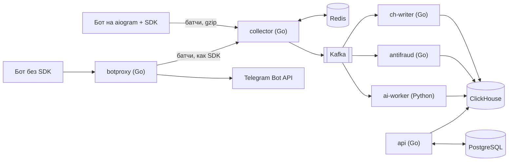

# Botsight

Botsight — сервис аналитики для Telegram-ботов. Владелец бота устанавливает Python-пакет `botsight`, добавляет две строки в код запуска бота на aiogram 3 и получает дашборд. В нём видно, откуда приходят пользователи, на каком шаге сценария они уходят, кто блокирует бота, какие ошибки возникают в хендлерах и запросах к Telegram, о чём пользователи пишут боту и какая часть трафика похожа на ботофермы. Хендлеры бота менять не нужно.

```python
from botsight import setup

setup(dp, bot, api_key=os.environ["BOTSIGHT_KEY"])
await dp.start_polling(bot)
```

SDK работает внутри процесса бота и отправляет на сервер только события. Токен бота не покидает инфраструктуру владельца, тексты сообщений по умолчанию не собираются. Если Botsight недоступен, бот продолжает работать как обычно. Для ботов на Go есть Go SDK (одна опция HTTP-клиента и middleware для `go-telegram/bot`), для ботов на других языках — режим прокси Bot API: достаточно поменять адрес Bot API.

Текущая версия — **0.1.0** ([изменения](CHANGELOG.md)): весь путь от бота до дашборда, разворачивается одной командой. Для продакшена ещё не всё готово, ограничения перечислены в [docs/operations.md](docs/operations.md#ограничения-010-и-что-нужно-до-продакшена).

## Документация

| Документ | О чём |
|---|---|
| [docs/architecture.md](docs/architecture.md) | как устроена система: путь события, гарантии доставки, топики Kafka, таблицы, изоляция клиентов |
| [docs/operations.md](docs/operations.md) | стенд, адреса сервисов, метрики, дашборды, SLO и алерты с подсказками, трассировка, безопасность, ограничения 0.1.0 |
| [backend/README.md](backend/README.md) | Go-сервисы: запуск, примеры запросов к API, все переменные окружения, миграции |
| [backend/api/openapi.yaml](backend/api/openapi.yaml) | API дашборда (OpenAPI 3) |
| [docs/contract/batch_v1.json](docs/contract/batch_v1.json) | контракт батча SDK → collector (JSON Schema) |
| [sdk/python/README.md](sdk/python/README.md), [sdk/go/README.md](sdk/go/README.md) | SDK: подключение, что собирается, параметры, гарантии |
| [web/README.md](web/README.md) | дашборд: экраны, устройство, проверки |
| [ai/README.md](ai/README.md) | AI-модуль: темы, вопросы на естественном языке, аномалии |
| [loadtest/README.md](loadtest/README.md) | хаос-тесты и их результаты до и после исправления |
| [Botsight.md](Botsight.md) | проектный документ: продукт, архитектура, решения и их обоснования, планы |
| [CHANGELOG.md](CHANGELOG.md) | что вошло в каждую версию |

## Архитектура



| Часть | Что делает | Код |
|---|---|---|
| SDK | middleware aiogram 3: входящие апдейты, шаги FSM, вызовы Bot API, блокировки; очередь в памяти, батчи, ретраи | [sdk/python](sdk/python) |
| Go SDK | `http.RoundTripper` для любого Go-бота и адаптер `go-telegram/bot`: вызовы Bot API, апдейты, время и паники хендлеров; без зависимостей в ядре | [sdk/go](sdk/go) |
| `collector` | приём батчей: ключи с кэшем и singleflight, дедупликация и лимит одним Lua-скриптом в Redis, запись в Kafka с `acks=all` | [backend/internal/ingest](backend/internal/ingest) |
| `ch-writer` | Kafka → ClickHouse пачками без потерь и дублей при падении между вставкой и коммитом смещения, DLQ | [backend/internal/chwriter](backend/internal/chwriter) |
| `api` | аккаунты, проекты, ключи (PostgreSQL); аналитика из ClickHouse — обзор, воронки (`windowFunnel`), источники и стоимость пользователя, когорты (`retention`), ошибки, граф FSM, таймлайн; живая лента событий по SSE из Kafka; рассылки по сегментам | [backend/internal/httpapi](backend/internal/httpapi), [backend/internal/query](backend/internal/query), [OpenAPI](backend/api/openapi.yaml) |
| `botproxy` | шлюз к Bot API для ботов без SDK: поток без буферизации, long polling, вебхуки, дедупликация апдейтов | [backend/internal/botproxy](backend/internal/botproxy) |
| `antifraud` | доля ботоферм по источникам: признаки пользователей из потока, скоринг, реферальный граф | [backend/internal/antifraud](backend/internal/antifraud) |
| Дашборд | React + TypeScript: подключение бота с ожиданием первого события по SSE, обзор, живая лента, воронки, источники, удержание, граф сценария, ошибки, таймлайн, рассылки, антифрод, AI, настройки; типы API генерируются из OpenAPI | [web](web) |
| `ai-worker` | темы сообщений (эмбеддинги + HDBSCAN), вопросы на естественном языке → проверенный SQL, объяснение аномалий | [ai](ai) |

## Инженерные решения

- **Доставка без потерь и дублей.** SDK повторяет батч с тем же `batch_id`, и collector принимает его один раз. Ответ `202` уходит только после подтверждения Kafka. ch-writer переживает падение между вставкой в ClickHouse и коммитом смещения без дублей: это проверяет интеграционный тест, а e2e в CI сверяет каждое принятое событие с ClickHouse.
- **Аналитика без SQL-инъекций.** Запросы строятся из типизированных определений, значения передаются только серверными параметрами ClickHouse `{name:Type}`. Ответы кэшируются в Redis на минуту, у запросов есть лимиты, независимые запросы экрана выполняются параллельно.
- **Прокси Bot API.** Загрузки до 50 МБ идут потоком (чтобы найти `chat_id`, копируются только первые 4 КиБ), транспорт настроен на тысячи одновременных long polling-соединений. Повторные апдейты отсекает скользящее окно, как анти-replay в IPsec. `setWebhook` переписывается на адрес шлюза, а SSRF закрыт проверкой IP в диалере.
- **Рассылки по сегментам.** Сегмент строится из аналитики, получатели образуют очередь в PostgreSQL (`FOR UPDATE SKIP LOCKED` с арендой и лимитом попыток), а отправляет SDK внутри бота через токен-бакет под лимиты Telegram (429 `retry_after`, блокировки). Тысячи ботов опрашивают сервер, не трогая базу, благодаря флагу в Redis.
- **Изоляция клиентов.** `project_id` берётся только из ключа или сессии, чужой проект отвечает `404`. SQL от LLM выполняется под пользователем ClickHouse с row policy на один проект.
- **Горячий путь по профилю.** Бенчмарк и pprof приёма батча показали, на что уходят память и CPU. Своё кодирование записей, байт в байт совпадающее с `json.Marshal`, и разбор свойств без пробных `Unmarshal` дали −29 % времени и −51 % аллокаций (benchstat).
- **Хаос-тесты.** Под нагрузкой роняются collector, ch-writer, Kafka и ClickHouse, сеть ломается через toxiproxy, затем ClickHouse сверяется с журналом генератора. Первый прогон нашёл дубли при сбое Kafka — их закрыли транзакциями с групповой фиксацией; [отчёт до и после](loadtest/README.md).
- **Наблюдаемость как код.** Prometheus и Grafana поднимаются вместе со стеком. Дашборды генерируются из Python, SLO-алерты на бюджет ошибок с двумя скоростями сгорания покрыты `promtool test rules`, свежесть данных от Kafka до ClickHouse меряется отдельной метрикой. Сквозная трассировка OpenTelemetry: трейс батча начинается в collector, идёт в заголовках Kafka и заканчивается в ch-writer после коммита, его видно в Jaeger и Grafana.
- **Тесты.** Интеграционные тесты поднимают PostgreSQL, Redis, Kafka и ClickHouse через testcontainers. e2e в CI запускает всё окружение в docker compose, гонит нагрузку `loadgen` и проверяет данные в ClickHouse, темы ИИ, точность антифрода и ответы API аналитики.

## Быстрый старт

Нужны Docker с Compose, Go 1.26 для генератора нагрузки и Node.js 24 для дашборда (версии из CI).

**1. Поднять стек.** Из корня репозитория:

```bash
docker compose -f deploy/docker-compose.yml up -d --build
```

Первая сборка занимает несколько минут. Поднимутся хранилища, применятся миграции, запустятся все сервисы, Prometheus, Grafana и Jaeger. Адреса — в [docs/operations.md](docs/operations.md#стенд-в-docker-compose).

**2. Запустить дашборд:**

```bash
cd web && npm install && npm run dev     # http://localhost:5173
```

**3. Наполнить данными.** Генератор создаёт аккаунт и проекты и шлёт трафик ботов в формате SDK, включая тексты для AI и ботофермы для антифрода:

```bash
cd backend && go run ./cmd/loadgen -projects 3 -users 500 -rate 3000 -duration 30s -texts -fraud 0.2
```

В конце он печатает почту аккаунта, пароль — `loadgen-password`. Войдите с ними на http://localhost:5173.

**4. Подключить своего бота.** Зарегистрируйтесь в дашборде, создайте проект и скопируйте ключ: он показывается один раз. Затем передайте SDK ключ и адрес collector:

```python
from botsight import setup

setup(dp, bot, api_key="bs_live_...", endpoint="http://localhost:8081")
```

Экран подключения покажет «Бот подключён», как только придёт первое событие. Боты на других языках подключаются через прокси Bot API: адрес Bot API меняется на `http://localhost:8084/k/<ключ>` (см. [backend/README.md](backend/README.md#настройки-botproxy)).

**5. Посмотреть, как работает система изнутри:**
- Grafana на http://localhost:3000 — дашборды «Приём и конвейер», «API и аналитика», «SLO»;
- Jaeger на http://localhost:16686 — трейс батча от collector до ClickHouse.

## Установка SDK

Python SDK пока не опубликован в PyPI, его ставят из репозитория по тегу версии:

```bash
pip install "botsight @ git+https://github.com/Artem-Kornilov-pro/Botsight.git@v0.1.0#subdirectory=sdk/python"
```

Go SDK — отдельный модуль в подкаталоге, у него свой тег `sdk/go/v0.1.0`:

```bash
go get github.com/Artem-Kornilov-pro/Botsight/sdk/go@v0.1.0
```

При самостоятельном развёртывании передайте SDK адрес своего collector: `endpoint=...` в Python, `botsight.WithEndpoint(...)` в Go.

## Тесты

```bash
cd backend && go test -race ./...     # Go; интеграционные тесты поднимают зависимости через testcontainers, нужен Docker
cd sdk/python && pytest               # Python SDK
cd sdk/go && go test -race ./...      # Go SDK
cd ai && pytest                       # ai-worker
cd web && npm test                    # дашборд; npm run e2e — Playwright против стека
loadtest/chaos.sh                     # хаос-тесты против стека, см. loadtest/README.md
```

В CI каждый компонент проверяется отдельным workflow (`.github/workflows`). e2e поднимает весь стек и сверяет данные, хаос-тесты запускаются каждую ночь.

## Версии

Версии следуют [SemVer](https://semver.org/lang/ru/). До 1.0.0 протокол SDK и API могут меняться в минорных версиях, такие изменения отмечаются в [CHANGELOG.md](CHANGELOG.md). Теги:
- `vX.Y.Z` — весь проект;
- `sdk/go/vX.Y.Z` — Go SDK, этого требует Go для модуля в подкаталоге.

## Стек

React + TypeScript (Vite, TanStack Query, ECharts, Playwright), Go 1.26 (chi, franz-go, clickhouse-go, pgx, go-redis, Prometheus), Python 3.12 (aiogram 3, FastAPI, fastembed, scikit-learn), Kafka 4 (KRaft), ClickHouse 25.8, PostgreSQL 17, Redis 7, Qdrant, Docker Compose, GitHub Actions.

## Лицензия

PolyForm Noncommercial 1.0.0: некоммерческое использование разрешено, коммерческое — только по отдельному соглашению с автором. Подробности в файле [LICENSE](LICENSE).
