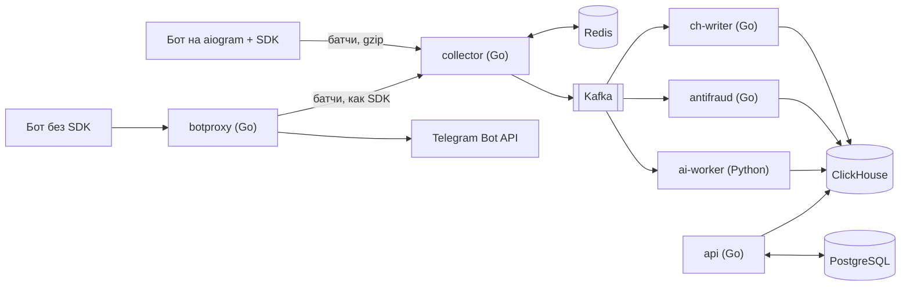

# Botsight

Botsight — сервис аналитики для Telegram-ботов. Владелец бота устанавливает Python-пакет `botsight`, добавляет две строки в код запуска бота на aiogram 3 и получает дашборд. В нём видно, откуда приходят пользователи, на каком шаге сценария они уходят, кто блокирует бота, какие ошибки возникают в хендлерах и запросах к Telegram, о чём пользователи пишут боту и какая часть трафика похожа на ботофермы. Хендлеры бота менять не нужно.

```python
from botsight import setup

setup(dp, bot, api_key=os.environ["BOTSIGHT_KEY"])
await dp.start_polling(bot)
```

SDK работает внутри процесса бота и отправляет на сервер только события. Токен бота не покидает инфраструктуру владельца, тексты сообщений по умолчанию не собираются. Если Botsight недоступен, бот продолжает работать как обычно. Для ботов без SDK есть режим прокси Bot API: достаточно поменять адрес Bot API.

Подробное проектирование — в [Botsight.md](Botsight.md).

## Архитектура



| Часть | Что делает | Код |
|---|---|---|
| SDK | middleware aiogram 3: входящие апдейты, шаги FSM, вызовы Bot API, блокировки; очередь в памяти, батчи, ретраи | [sdk/python](sdk/python) |
| `collector` | приём батчей: ключи с кэшем и singleflight, дедупликация и лимит одним Lua-скриптом в Redis, запись в Kafka с `acks=all` | [backend/internal/ingest](backend/internal/ingest) |
| `ch-writer` | Kafka → ClickHouse пачками без потерь и дублей при падении между вставкой и коммитом смещения, DLQ | [backend/internal/chwriter](backend/internal/chwriter) |
| `api` | аккаунты, проекты, ключи (PostgreSQL); аналитика из ClickHouse — обзор, воронки (`windowFunnel`), источники и стоимость пользователя, когорты (`retention`), ошибки, граф FSM, таймлайн; живая лента событий по SSE из Kafka | [backend/internal/httpapi](backend/internal/httpapi), [backend/internal/query](backend/internal/query), [OpenAPI](backend/api/openapi.yaml) |
| `botproxy` | шлюз к Bot API для ботов без SDK: поток без буферизации, long polling, вебхуки, дедупликация апдейтов | [backend/internal/botproxy](backend/internal/botproxy) |
| `antifraud` | доля ботоферм по источникам: признаки пользователей из потока, скоринг, реферальный граф | [backend/internal/antifraud](backend/internal/antifraud) |
| `ai-worker` | темы сообщений (эмбеддинги + HDBSCAN), вопросы на естественном языке → проверенный SQL, объяснение аномалий | [ai](ai) |

Дашборд на React — следующий этап.

## Инженерные решения

- **Доставка без потерь и дублей.** SDK повторяет батч с тем же `batch_id`, и collector принимает его один раз. Ответ `202` уходит только после подтверждения Kafka. ch-writer переживает падение между вставкой в ClickHouse и коммитом смещения без дублей: это проверяет интеграционный тест, а e2e в CI сверяет каждое принятое событие с ClickHouse.
- **Аналитика без SQL-инъекций.** Запросы строятся из типизированных определений, значения передаются только серверными параметрами ClickHouse `{name:Type}`. Ответы кэшируются в Redis на минуту, у запросов есть лимиты, независимые запросы экрана выполняются параллельно.
- **Прокси Bot API.** Загрузки до 50 МБ идут потоком (чтобы найти `chat_id`, копируются только первые 4 КиБ), транспорт настроен на тысячи одновременных long polling-соединений. Повторные апдейты отсекает скользящее окно, как анти-replay в IPsec. `setWebhook` переписывается на адрес шлюза, а SSRF закрыт проверкой IP в диалере.
- **Изоляция клиентов.** `project_id` берётся только из ключа или сессии, чужой проект отвечает `404`. SQL от LLM выполняется под пользователем ClickHouse с row policy на один проект.
- **Тесты.** Интеграционные тесты поднимают PostgreSQL, Redis, Kafka и ClickHouse через testcontainers. e2e в CI запускает всё окружение в docker compose, гонит нагрузку `loadgen` и проверяет данные в ClickHouse, темы ИИ, точность антифрода и ответы API аналитики.

## Запуск

Нужен Docker.

```bash
docker compose -f deploy/docker-compose.yml up --build
```

Поднимутся хранилища, применятся миграции, запустятся все сервисы. Адреса, настройки и примеры запросов — в [backend/README.md](backend/README.md). Нагрузка и демо-данные:

```bash
cd backend && go run ./cmd/loadgen -projects 3 -users 500 -rate 3000 -duration 30s -texts -fraud 0.2
```

Тесты:

```bash
cd backend && go test -race ./...     # Go; интеграционные тесты используют Docker
cd sdk/python && pytest               # SDK
cd ai && pytest                       # ai-worker
```

## Стек

Go 1.26 (chi, franz-go, clickhouse-go, pgx, go-redis, Prometheus), Python 3.12 (aiogram 3, FastAPI, fastembed, scikit-learn), Kafka 4 (KRaft), ClickHouse 25.8, PostgreSQL 17, Redis 7, Qdrant, Docker Compose, GitHub Actions.

## Лицензия

PolyForm Noncommercial 1.0.0: некоммерческое использование разрешено, коммерческое — только по отдельному соглашению с автором. Подробности в файле [LICENSE](LICENSE).
