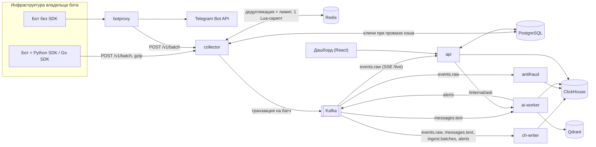
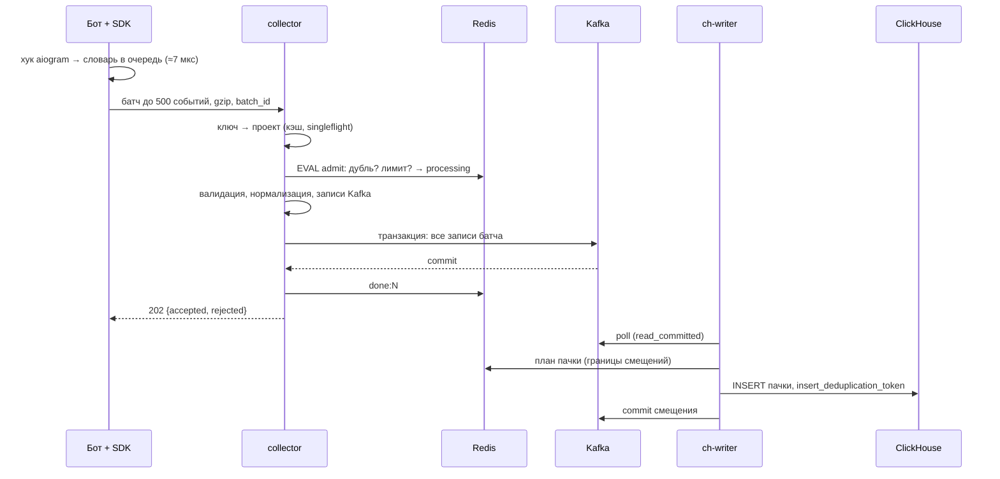

# Архитектура Botsight 0.1.0

Документ описывает, как система устроена в версии 0.1.0: что реализовано, а не что запланировано. Проектирование целиком, с обоснованиями и планами, — в [Botsight.md](../Botsight.md). Ссылки вида «§10.4» ведут на его разделы.

## Компоненты

| Компонент | Язык | Состояние | Масштабирование |
|---|---|---|---|
| `collector` | Go | без состояния; кэш ключей в памяти | горизонтально за балансировщиком |
| `ch-writer` | Go | смещения в Kafka, планы пачек в Redis | партиции Kafka (consumer group) |
| `antifraud` | Go | признаки пользователей в памяти, восстанавливаются перечитыванием 24 ч | партиции Kafka |
| `api` | Go | без состояния; сессии и кэш аналитики в Redis | горизонтально |
| `botproxy` | Go | адреса вебхуков в Redis | горизонтально |
| `ai-worker` | Python | векторы в Qdrant, блокировки в Redis | `embed` — партиции Kafka, `topics`/`anomalies` — блокировки в Redis |
| дашборд | TypeScript | — | статика |

## Путь события

1. **SDK** работает внутри процесса бота. На пути апдейта он только собирает словарь и кладёт его в очередь в памяти. Сеть, сериализация и gzip выполняются в фоне. Батч уходит при 500 событиях или раз в 2 секунды. При ошибке он повторяется с тем же `batch_id` с экспоненциальной паузой до 10 минут. Токен бота и тексты сообщений (если их сбор не включён) не покидают процесс.
2. **collector** (§10):
   - **ключ проекта** проверяется по кэшу в памяти, в PostgreSQL он идёт только при промахе, через singleflight; отзыв ключа рассылается через Redis pub/sub;
   - **тело** читается с лимитом до и после распаковки (2 МиБ), поэтому zip-бомба останавливается на лимите;
   - **дедупликация батча и лимит проекта** проверяются одним Lua-скриптом в Redis (§10.4);
   - **события** проверяются по контракту [docs/contract/batch_v1.json](contract/batch_v1.json) и нормализуются. Неверное событие отклоняется поштучно, батч из-за него не падает;
   - **запись в Kafka:** все записи батча пишутся одной транзакцией. Транзакции одновременных запросов группируются: 4 параллельные транзакции, ожидание 2 мс. Ответ `202` уходит только после фиксации.
3. **Kafka** — шина и буфер на случай недоступности ClickHouse. Ключ записи — `project:user`, поэтому события одного пользователя идут в одну партицию по порядку.
4. **ch-writer** (§11.2–11.3):
   - у каждой партиции своя горутина, она собирает пачку до 50 000 строк или 1 секунды;
   - перед вставкой границы пачки сохраняются в Redis, вставка идёт с `insert_deduplication_token`, смещение коммитится только после неё;
   - после падения между вставкой и коммитом следующий владелец партиции собирает ту же пачку, и ClickHouse отбрасывает повтор;
   - нечитаемая запись уходит в `events.dlq` с причиной в заголовках;
   - пока ClickHouse недоступен, чтение партиций ставится на паузу, данные ждут в Kafka.
5. **ClickHouse** хранит события. Материализованные представления считают дневные агрегаты и первое касание пользователя.

Свежесть — от записи в Kafka до вставки — меряется метрикой `botsight_ch_freshness_seconds`, цель p95 < 10 с. При малом трафике её определяет таймер сброса ch-writer (1 с): это видно в трейсе батча ([operations.md](operations.md#трассировка)).

## Гарантии доставки

| Сбой | Что происходит | Чем проверено |
|---|---|---|
| ответ collector потерян в сети | SDK повторяет батч с тем же `batch_id`, collector отвечает `202 duplicate` и не пишет его второй раз | хаос-тест `network` |
| collector упал посреди запроса | ответа не было, SDK повторяет; ключ `processing` в Redis истекает через 2 минуты | хаос-тест `collector_kill` |
| Kafka остановилась посреди записи батча | транзакция не фиксируется, потребители `read_committed` её не видят, collector отвечает `503`, повтор пишет батч целиком | хаос-тест `kafka_stop` (до транзакций давал 219 дублей) |
| ch-writer упал между вставкой и коммитом | новая пачка собирается по плану из Redis с теми же границами и токеном, ClickHouse отбрасывает повтор | хаос-тест `chwriter_kill`, интеграционный тест |
| ClickHouse недоступен | вставки повторяются с паузой, чтение партиций на паузе, лаг растёт в Kafka и догоняется после восстановления | хаос-тест `clickhouse_pause` |
| Botsight недоступен целиком | бот работает как обычно, SDK копит до 10 000 событий и досылает их, сверх — считает потери в поле `dropped` | тесты SDK |

Итог: в пределах хранения Kafka (72 часа) каждое принятое событие попадает в ClickHouse ровно один раз. Хаос-тесты сверяют это под нагрузкой: строк в ClickHouse = уникальных `event_id` = событий в журнале генератора ([loadtest/README.md](../loadtest/README.md)).

## Топики Kafka

| Топик | Партиций | Хранение | Пишет | Читает |
|---|---|---|---|---|
| `events.raw` | 24 | 72 ч | collector | ch-writer → `events`; antifraud; api (`/live`) |
| `messages.text` | 12 | 24 ч | collector, только проекты с `capture_text` | ch-writer → `messages_text`; ai-worker |
| `ingest.batches` | 6 | 72 ч | collector, одна запись на батч (версии SDK, `dropped`) | ch-writer → `ingest_batches` |
| `alerts` | 3 | 7 дней | ai-worker, antifraud | ch-writer → `alerts` |
| `events.dlq` | 3 | 7 дней | ch-writer | разбор вручную |

Все потребители читают `read_committed`. Заголовки записи: `project_id`, `schema_version` и у батчей из выборки трассировки — `traceparent`.

## Хранилища

**ClickHouse** (`migrations/clickhouse/`):

| Таблица | Что | Ключ сортировки, хранение |
|---|---|---|
| `events` | все события | `(project_id, bot_id, day, user_id, ts)`, партиции по месяцу, 13 месяцев |
| `events_daily` | дневные агрегаты (MV), быстрые обзоры | `AggregatingMergeTree` |
| `user_first_start` | первое касание пользователя для атрибуции (MV) | `AggregatingMergeTree` |
| `messages_text` | тексты сообщений проектов с `capture_text` | 30 дней |
| `ingest_batches` | метаданные батчей: SDK, фреймворк, потери | 13 месяцев |
| `message_points`, `topics`, `point_topics` | темы сообщений (ai-worker) | — |
| `user_features`, `user_risk`, `source_risk`, `referral_flags` | антифрод | — |
| `alerts` | алерты тем, аномалий и антифрода | — |

**PostgreSQL** (`migrations/postgres/`) — control plane:
- `accounts`, `account_tokens` — аккаунты, подтверждение почты, сброс пароля;
- `projects`, `project_members` — проекты, участники и роли;
- `api_keys` — хранится только SHA-256 ключа;
- `saved_funnels`, `ad_spend` — сохранённые воронки и расходы на рекламу;
- `broadcasts`, `broadcast_recipients` — рассылки и очередь получателей.

**Redis:**
- дедупликация батчей и токен-бакеты проектов;
- сессии дашборда и кэш ответов аналитики на минуту;
- планы пачек ch-writer;
- адреса вебхуков botproxy;
- флаги рассылок и блокировки ai-worker.

**Qdrant** — векторы сообщений для тем.

## Аналитика

`api` строит запросы к ClickHouse из типизированных определений (`backend/internal/query`), значения передаются только серверными параметрами `{name:Type}`. Поэтому SQL-инъекция невозможна по построению. Воронки считаются через `windowFunnel`, удержание — через `retention`, источники — по первому касанию из `user_first_start`. Независимые запросы экрана выполняются параллельно, ответы кэшируются в Redis на минуту. У запросов есть лимиты времени и памяти.

Вопросы на естественном языке проходят так: LLM пишет SQL, `ai-worker` проверяет его и выполняет под пользователем ClickHouse `nl_p{project_id}` с row policy на один проект. Даже ошибочный или вредный SQL не видит чужие данные.

## Изоляция клиентов

`project_id` берётся только из API-ключа (collector) или из сессии и членства в проекте (api), а не из тела запроса. Чужой проект отвечает `404`, а не `403`, чтобы не раскрывать, что он существует. Лимит приёма — на проект: шумный клиент упирается в свой токен-бакет и не забирает пропускную способность у остальных.

## Режим прокси Bot API

Для ботов без SDK `botproxy` встаёт между ботом и Telegram: бот меняет только базовый адрес Bot API на `http://<botproxy>/k/<api_key>`.
- **Запросы** передаются потоком, загрузки до 50 МБ не буферизуются: для поиска `chat_id` копируются первые 4 КиБ.
- **Long polling** работает через транспорт, рассчитанный на тысячи одновременных соединений.
- **Вебхуки:** `setWebhook` переписывается на адрес шлюза, исходный адрес хранится в Redis. SSRF закрыт проверкой IP в диалере.
- **Повторные апдейты** отсекает скользящее окно по `update_id`.

## Рассылки

Сегмент строится из аналитики, получатели записываются в очередь в PostgreSQL. Отправляет сам бот через SDK, поэтому токен остаётся у владельца:
- SDK арендует получателей пачками (`FOR UPDATE SKIP LOCKED`, аренда с истечением, лимит попыток);
- отправляет их через токен-бакет под лимиты Telegram;
- возвращает результаты.

Тысячи ботов опрашивают сервер, не трогая базу: флаг «есть работа» лежит в Redis.

## Производительность

Замеры на одном ноутбуке (Apple M5, всё в docker compose):

- **Приём:** около 200 000 событий/с одним инстансом collector при 64 параллельных отправителях, все ответы `202` (§18.2).
- **CPU одного батча** из 500 событий в collector — около 0,9 мс (`BenchmarkHotPath`, §10.5).
- **Накладные расходы SDK** на апдейт — около 7 мкс.

Это верхняя оценка одной машины: генератор и все сервисы делят ядра.
